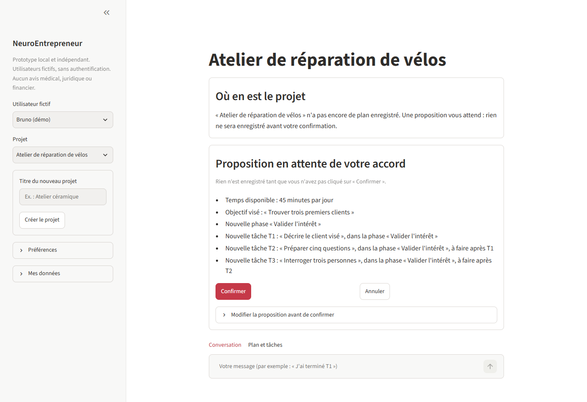
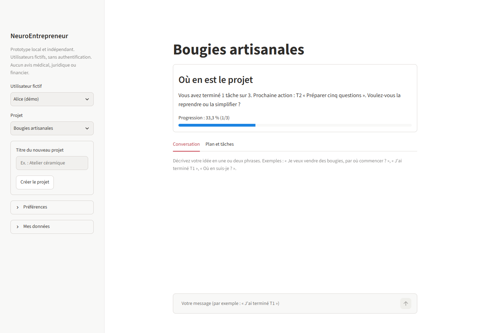
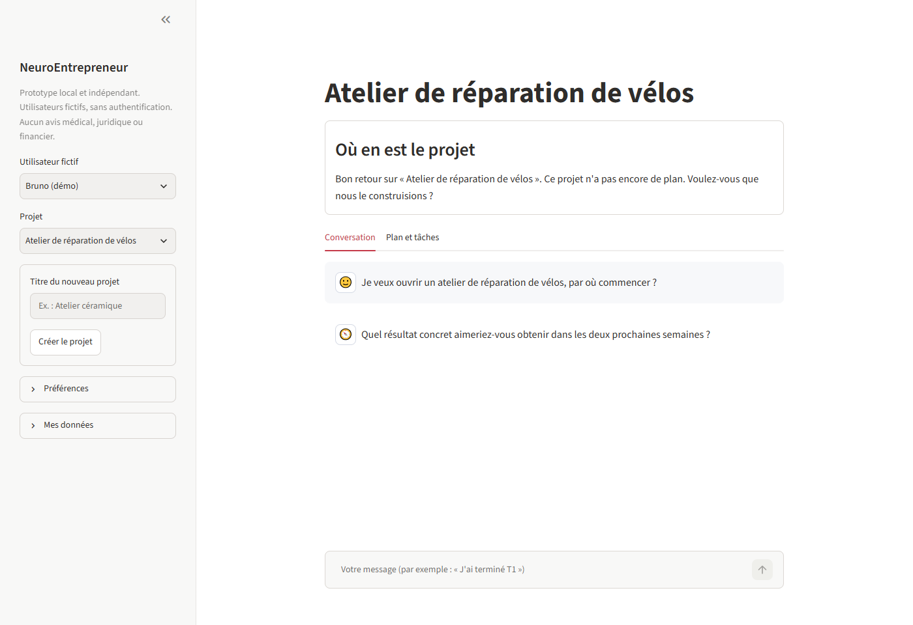
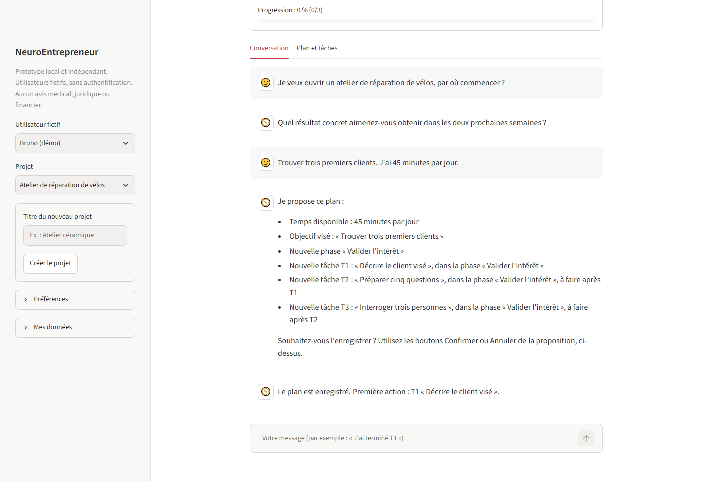
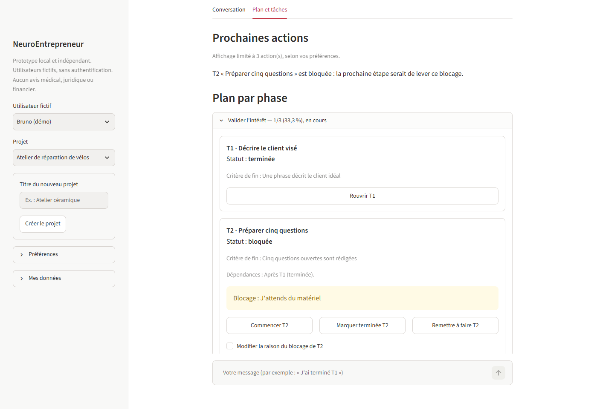
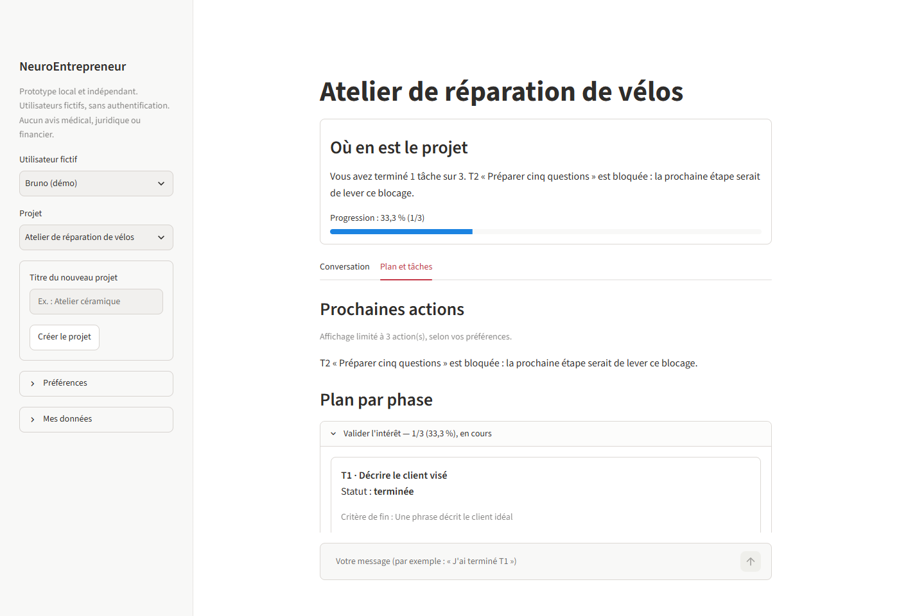
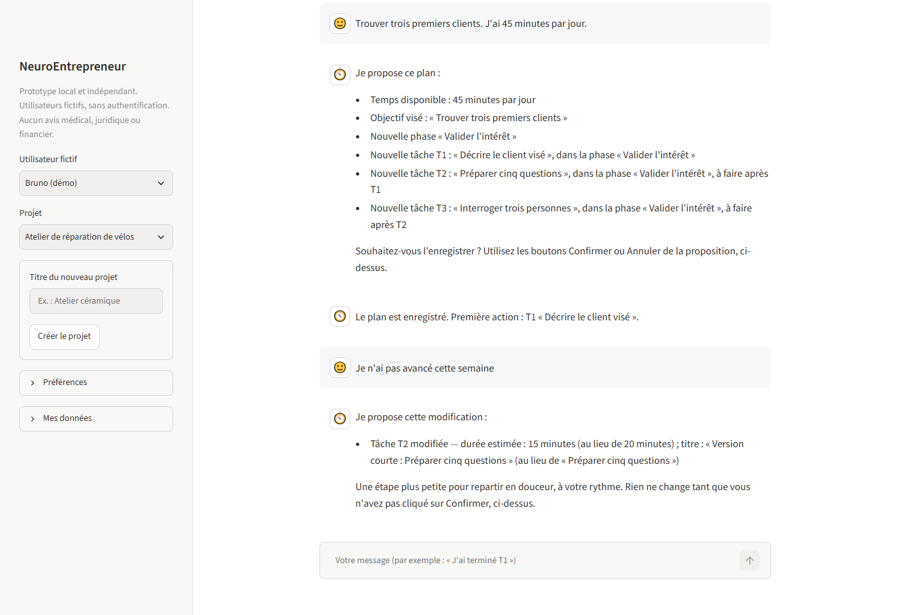
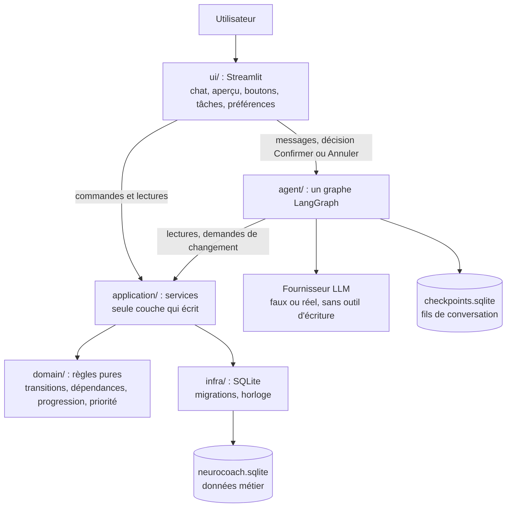
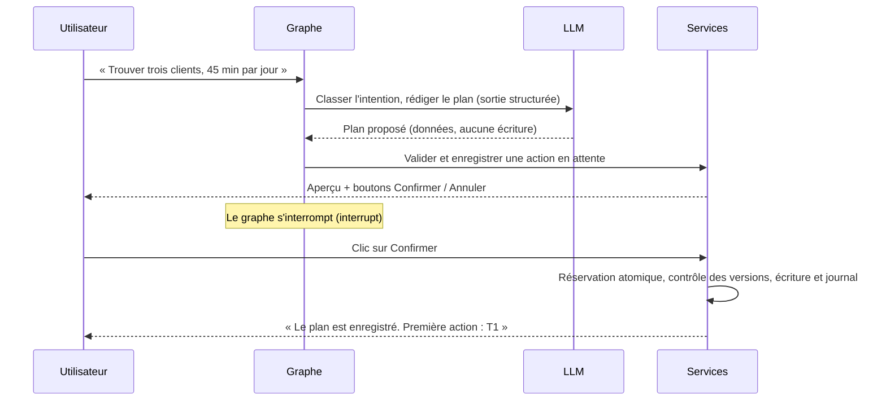

# NeuroEntrepreneur AI Coach

**Coach conversationnel qui aide un porteur de projet à passer d'une idée floue à un plan de micro-tâches, puis à suivre sa progression réelle. Le modèle de langage propose, le code vérifie, et rien n'est enregistré sans un clic de l'utilisateur.**

> **Prototype indépendant de portfolio.** Ce projet n'est **pas affilié officiellement à Fantas.IA** et n'est pas son produit. Il s'inspire de besoins exprimés publiquement, sans connaissance de son cahier des charges interne.
> Ce n'est **pas un dispositif médical** : aucun diagnostic, aucun avis médical, juridique ou financier.
> Ce n'est **pas un logiciel prêt pour la production** : usage local, utilisateurs fictifs, sans authentification (voir [Limites](#limites)).
> **Le comportement avec un vrai modèle de langage n'est validé que pour OpenAI `gpt-5-mini`** (quatre campagnes et des validations ciblées, effort `low`, validation finale 15/15) : garanties de sécurité tenues ; limites documentées. La démonstration et la suite de tests utilisent un faux fournisseur déterministe.



## Sommaire
- [Le problème](#le-problème)
- [La solution](#la-solution)
- [Fonctionnalités](#fonctionnalités)
- [Captures](#captures)
- [Architecture](#architecture)
- [Technologies](#technologies)
- [Installation](#installation)
- [Utilisation et démonstration](#utilisation-et-démonstration)
- [Utiliser un vrai modèle de langage](#utiliser-un-vrai-modèle-de-langage)
- [Activer la recherche web](#activer-la-recherche-web)
- [Tests et qualité](#tests-et-qualité)
- [Limites](#limites)
- [Structure du dépôt](#structure-du-dépôt)
- [Licence et attributions](#licence-et-attributions)

## Le problème

Lancer un projet entrepreneurial demande de transformer une intention vague (« je veux vendre des bougies, mais par où commencer ? ») en actions concrètes, puis de s'y tenir sur plusieurs semaines. Deux écueils reviennent souvent :

- **La surcharge** : trop de questions, des plans trop longs, des listes de tâches qui découragent.
- **Le manque de fiabilité des assistants IA** : un modèle de langage peut inventer un pourcentage d'avancement, modifier un plan sans le dire, ou « oublier » ce qui a été convenu.

## La solution

Un coach conversationnel en français, qui garde l'utilisateur maître de chaque décision :

1. **Clarifier** l'idée par une seule question à la fois, qu'il est possible de passer.
2. **Proposer** un plan court de micro-tâches, avec des critères de fin vérifiables.
3. **Faire approuver** explicitement : chaque modification importante est prévisualisée, puis confirmée par un bouton. Un « oui » écrit dans le chat ne suffit pas.
4. **Suivre** l'avancement de manière déterministe : statuts, blocages, dépendances et pourcentages sont calculés par le code, jamais par le modèle.
5. **Reprendre** après une interruption, avec un résumé factuel tiré de la base de données.

L'expérience s'adapte à des **préférences choisies par l'utilisateur** (longueur des réponses, nombre d'actions visibles, rythme), sans aucune inférence de diagnostic.

## Fonctionnalités

| Domaine | Ce qui fonctionne |
|---|---|
| Conversation | Clarification une question à la fois, plan proposé, replanification sans jugement (« Je n'ai pas avancé »), changements de statut en langage naturel (« J'ai terminé T1 ») |
| Approbation | Proposition en attente, valable 15 minutes et à usage unique ; Confirmer ou Annuler ; correction du plan proposé avant confirmation ; un nouveau message annule la proposition sans rien écrire |
| Suivi | Plan par phase, statuts (à faire, en cours, terminée, bloquée), raison de blocage obligatoire, dépendances, prochaines actions priorisées, progression calculée, annulation du dernier changement |
| Reprise | Historique et résumé identiques après un redémarrage ; un fil de conversation par projet |
| Préférences | Réponses courtes, standard ou détaillées ; 1 à 3 actions visibles ; rythme ; échéances facultatives ; jamais modifiées par le modèle |
| Données | Export JSON de ses propres données, suppression d'un projet, effacement complet (conversations comprises), après confirmation |
| Sécurité | Isolation entre utilisateurs et entre projets ; le modèle n'a aucun outil d'écriture ; les injections dans le chat ne peuvent déclencher aucune écriture |

## Captures

Captures réelles de l'interface, prises par un navigateur sans fenêtre sur des **données fictives**, avec le **faux fournisseur LLM** (`scripts/capture_screenshots.py`). Détail dans [docs/screenshots/](docs/screenshots/README.md).

| | |
|---|---|
|  **Accueil :** résumé factuel du projet et progression |  **Clarification :** une seule question |
|  **Confirmation :** le plan n'est enregistré qu'après le clic |  **Tâches :** statuts, blocage avec raison, dépendances |
|  **Progression :** calculée par le code (33,3 %) |  **Replanification :** une étape plus petite, proposée sans être appliquée |

## Architecture

Un **seul graphe LangGraph**, sans multi-agent ni RAG. Le routage est décidé par le code à partir de l'intention classée par le modèle.



**Le parcours d'une modification sensible :**



**Principes vérifiés par les tests :**
- Le modèle ne décide jamais d'une progression, d'un statut, d'une permission ni d'une écriture.
- L'identité vient du contexte d'exécution fourni par le serveur, jamais du chat ni d'un checkpoint.
- Toute écriture soumise à confirmation passe par une action en attente stockée en base : usage unique, expiration, versions attendues, idempotence.
- Les faits affichés (progression, résumé, prochaines actions) sont produits par des gabarits déterministes.

Détails : [docs/ARCHITECTURE.md](docs/ARCHITECTURE.md), [docs/DOMAIN_CONTRACTS.md](docs/DOMAIN_CONTRACTS.md) et [docs/DECISIONS.md](docs/DECISIONS.md).

## Technologies

| Rôle | Choix |
|---|---|
| Langage | Python 3.13 |
| Orchestration | LangGraph (`interrupt`, `Command`, `context_schema`), checkpoints SQLite |
| Modèles | Faux fournisseur déterministe par défaut ; Anthropic ou OpenAI via LangChain, en option |
| Validation | Pydantic 2 (sorties structurées, schémas fermés) |
| Persistance | SQLite (deux bases : métier et conversations), migrations SQL |
| Interface | Streamlit |
| Qualité | pytest, pytest-cov, ruff, analyse des secrets maison, GitHub Actions |

## Installation

Prérequis : **Python 3.13** et Git. Aucune clé d'API n'est nécessaire avec le fournisseur par défaut.

**Windows (PowerShell)**

```powershell
git clone <url-du-depot> NeuroEntrepreneur
cd NeuroEntrepreneur
py -3.13 -m venv .venv
.\.venv\Scripts\python.exe -m pip install -e ".[dev,agent,ui]"
```

**Linux ou macOS**

```bash
git clone <url-du-depot> NeuroEntrepreneur
cd NeuroEntrepreneur
python3.13 -m venv .venv
.venv/bin/python -m pip install -e ".[dev,agent,ui]"
```

Pour reproduire exactement l'environnement de développement : `pip install -r requirements.lock`, puis `pip install -e . --no-deps`.

## Utilisation et démonstration

Toutes les commandes passent par `scripts/dev.py` (sans `make`). Sous Linux ou macOS, remplacer `.\.venv\Scripts\python.exe` par `.venv/bin/python`.

```powershell
.\.venv\Scripts\python.exe scripts\dev.py seed    # Alice et Bruno, utilisateurs fictifs
.\.venv\Scripts\python.exe scripts\dev.py demo    # interface sur http://localhost:8501
```

| Commande | Effet |
|---|---|
| `test` | Toute la suite pytest, sans appel réseau |
| `cov` | Tests et couverture (`domain`, `application`, `agent`), échec sous 90 % |
| `lint` | `ruff check` et vérification du formatage |
| `check-secrets` | Recherche de secrets dans les fichiers destinés à Git |
| `check-llm` | Contrôle la configuration d'un fournisseur réel, sans afficher la clé |
| `seed` / `reset-data` | Données de démonstration fictives / suppression des bases locales |
| `licenses` | Regénère la liste des licences des dépendances installées |

**Phrases reconnues par le faux fournisseur :** « Je veux ouvrir un atelier de réparation de vélos, par où commencer ? », « Trouver trois premiers clients. J'ai 45 minutes par jour. », « J'ai terminé T1 », « T2 est bloquée car … », « Où en suis-je ? », « Je n'ai pas avancé cette semaine ».

- Scénario minuté de 3 à 5 minutes : [docs/DEMO_SCRIPT.md](docs/DEMO_SCRIPT.md).
- Guide d'enregistrement vidéo : [docs/VIDEO_GUIDE.md](docs/VIDEO_GUIDE.md).
- Guide de développement : [docs/DEVELOPMENT.md](docs/DEVELOPMENT.md).

## Utiliser un vrai modèle de langage

Facultatif et payant. Les clés se placent **uniquement** dans un fichier `.env` local, ignoré par Git.

```powershell
.\.venv\Scripts\python.exe -m pip install -e ".[anthropic]"   # ou ".[openai]"
Copy-Item .env.example .env                                   # puis éditer .env
```

Dans `.env` : `NEUROCOACH_LLM_PROVIDER=anthropic`, `NEUROCOACH_LLM_MODEL=<identifiant du modèle>` et `ANTHROPIC_API_KEY=<votre clé>` (ou `openai` et `OPENAI_API_KEY`).
Modèle actuellement retenu : `gpt-5-mini`. Il sera retiré de l'API d'OpenAI le 11/12/2026, d'où une architecture multi-modèle prête mais pas encore utilisée pour une bascule. Évaluations réelles déjà menées et leurs limites : [docs/R0_RESULTS.md](docs/R0_RESULTS.md) et [docs/R0_CONFIRMATION_RESULTS.md](docs/R0_CONFIRMATION_RESULTS.md). Exploitation, changement de modèle, retour arrière et migration : [docs/MODEL_OPERATIONS.md](docs/MODEL_OPERATIONS.md). Premiers pas : [docs/REAL_LLM_CHECKLIST.md](docs/REAL_LLM_CHECKLIST.md).

## Activer la recherche web

Dans la **conversation**, le coach propose une recherche quand vous hésitez entre plusieurs idées ou posez une question de concurrence, de prix, d'avis ou de risques ; il ne demande que ce qu'il ne sait pas encore, puis attend votre clic sur « Approuver et lancer » et résume les résultats avec leurs sources. Dites ensuite « analyse » : le modèle de stratégie étudie chaque idée (avantages, inconvénients, concurrents, prix sourcés, risques, adéquation à votre situation) et propose une recommandation prudente ; chaque affirmation est vérifiée contre les sources par le code. Les avis, forums et retours d'expérience autorisés sont résumés en thèmes, en distinguant le témoignage individuel de la tendance corroborée par plusieurs sites ; Reddit n'est pas consulté, faute d'autorisation de Reddit. Enfin, dites « cherche des solutions » : après une seconde approbation, le coach cherche des outils existants, logiciels libres et méthodes éprouvées pour les problèmes les mieux étayés, les compare au sur mesure, recommande et propose des actions ; « transforme ces actions en tâches » crée une proposition que vous confirmez ou annulez. Onglet **Recherche** d'un projet : vous approuvez une **mission** (objectif, marchés, types de recherche, services, données envoyées, budget), puis les recherches s'enchaînent dans ce périmètre. Rien n'est envoyé avant l'approbation ; le plan et les tâches ne sont jamais modifiés.

1. Créer un compte gratuit **Tavily** (1 000 crédits par mois, sans carte) et/ou **Exa** (10 $ par mois, sans carte), sans ajouter de moyen de paiement.
2. Copier chaque clé dans le fichier `.env` local : `TAVILY_API_KEY=...`, `EXA_API_KEY=...` (jamais dans Git, jamais affichée).
3. Vérifier sans appel : `python scripts/dev.py check-research` ; puis, si vous l'autorisez, **un** appel de test : `python scripts/check_research.py --ping --provider tavily --real-api --budget-usd 0.01`.
4. Redémarrer l'application.

Protections : plafond local mensuel inférieur à chaque offre gratuite (Tavily 6,40 $ = 800 crédits ; Exa 8 $), service suspendu jusqu'au mois suivant dès qu'un quota est signalé, une seule tentative par requête, budget par mission vérifié avant chaque requête, termes de santé et données personnelles retirés des requêtes. Exa : seules les références (URL, titre, date) sont conservées, conformément à ses conditions. Sans clé, la recherche n'est pas proposée ; la simulation (`NEUROCOACH_RESEARCH_SIMULATION=1`) sert uniquement à la démonstration hors ligne et est signalée partout. Détails : [docs/DECISIONS.md](docs/DECISIONS.md) (D-68, D-69) et [docs/RESEARCH_ROADMAP.md](docs/RESEARCH_ROADMAP.md).


Recette manuelle pas à pas, gratuite ou réelle : [docs/GUIDE_RECETTE_MANUELLE.md](docs/GUIDE_RECETTE_MANUELLE.md).

## Tests et qualité

<!-- Chiffres mis a jour a chaque phase depuis docs/IMPLEMENTATION_LOG.md -->
**Dernière exécution locale (Windows, Python 3.13, faux fournisseur) :** 800 tests réussis et 17 ignorés (les 16 dialogues avec un vrai modèle, et un test de configuration sans objet). Couverture totale : 98,10 %. Lint et analyse des secrets sans erreur.

La suite couvre :
- **Unitaires** : transitions, dépendances, priorité, progression, schémas.
- **Intégration** : SQLite, transactions, actions en attente, export, effacement.
- **Conversation** : clarification, plan, reprise, replanification, messages inattendus.
- **Sécurité** : isolation, injection de prompt, expiration, double clic, absence de secrets.
- **Résilience** : modèle indisponible, réponse invalide, base verrouillée, redémarrage.
- **Interface** : tests Streamlit `AppTest`.
- **Bout en bout** : le scénario de démonstration complet.

La CI GitHub Actions (`.github/workflows/ci.yml`) exécute le lint, les tests avec couverture et l'analyse des secrets sous Linux et Windows, sans clé ni appel réseau. Plan et résultats : [docs/VALIDATION_PLAN.md](docs/VALIDATION_PLAN.md).

## Limites

- **Validation avec un vrai modèle limitée à `gpt-5-mini`** (effort `low`) : quatre campagnes ont respecté toutes les garanties de sécurité ; la validation finale passe 15/15 aux contrôles automatiques. Les défauts relevés à la relecture (échéances proposées malgré leur désactivation, tutoiement, faits en double) sont corrigés par le code et couverts par des tests. Aucun autre modèle n'a été évalué.
- **Usage local uniquement** : pas d'authentification (deux utilisateurs fictifs à choisir dans une liste), pas de TLS, bases SQLite non chiffrées.
- **Accessibilité** : navigation au clavier vérifiée, mais aucun test avec un lecteur d'écran ; certains libellés de Streamlit restent en anglais.
- **Périmètre P0** : pas de notifications, pas d'API externe, pas de multi-agent ni de RAG ; une échéance ne peut pas être effacée par le chat.

Liste complète : [docs/LIMITATIONS.md](docs/LIMITATIONS.md) et [docs/SECURITY.md](docs/SECURITY.md).

## Structure du dépôt

```text
src/neurocoach/
  domain/        règles pures : modèles, transitions, dépendances, progression, priorité, plans
  infra/         SQLite : connexion, migrations, repositories, checkpoints
  application/   services, actions en attente, export, gabarits de texte
  agent/         graphe LangGraph, nœuds, routage, prompts, fournisseurs LLM, lanceur
ui/app.py        interface Streamlit
scripts/         dev.py, seed_demo.py, evaluate_llm.py, check_secrets.py, capture_screenshots.py
tests/           unit, integration, conversation, security, resilience, spikes, ui, e2e, real_llm
docs/            architecture, contrats, décisions, validation, sécurité, démo, captures
```

## Licence et attributions

- Code du projet : licence **MIT** ([LICENSE](LICENSE)).
- Quatre modules du domaine (`transitions`, `dependencies`, `priority`, `progress`) sont **adaptés de [Personal Progress Assistant AI](https://github.com/LancelotGalahad/Personal-Progress-Assistant-AI)** (MIT). Le copyright et le texte de licence d'origine sont conservés dans [THIRD_PARTY_NOTICES.md](THIRD_PARTY_NOTICES.md).
- D'autres dépôts ont été étudiés sans reprise de code ; en particulier, aucun code d'un dépôt sans licence n'a été copié. Détail dans [docs/REUSE_DECISIONS.md](docs/REUSE_DECISIONS.md).
- Licences des dépendances : [docs/DEPENDENCY_LICENSES.md](docs/DEPENDENCY_LICENSES.md).
