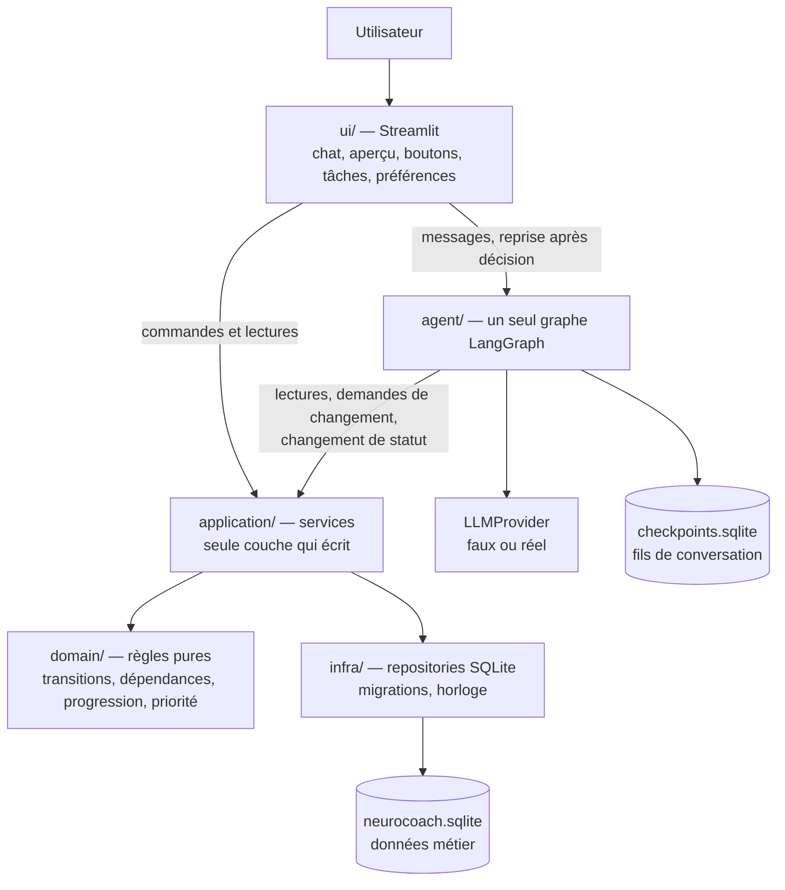
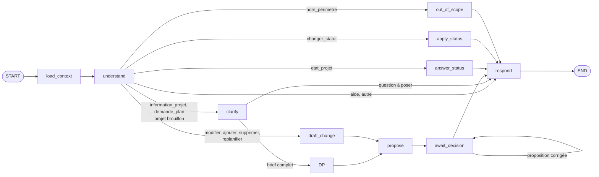

# Architecture — NeuroEntrepreneur AI Coach (P0)

**Version :** phase 0 — 9 novembre 2026
**Références :** `docs/DOMAIN_CONTRACTS.md` (règles), `docs/DECISIONS.md` (choix et arbitrages).

## 1. Vue d'ensemble



**Principes structurants :**
1. **Un seul graphe**, avec un routage décidé par le code.
2. **Le LLM propose, le domaine valide, le service écrit.**
3. Les écritures soumises à confirmation passent par une **action en attente** stockée en base. Elles sont appliquées par le service au moment où l'utilisateur confirme, et **jamais par le graphe ni par le LLM**.
4. Les **données métier** et les **checkpoints de conversation** sont dans deux fichiers SQLite distincts.

## 2. Arborescence cible

```text
NeuroEntrepreneur/
  README.md  THIRD_PARTY_NOTICES.md  LICENSE (MIT)
  .github/workflows/ci.yml          # CI : lint, tests, couverture, secrets (phase 5)
  pyproject.toml  requirements.lock  .env.example  .gitignore
  ui/app.py                         # point d'entrée Streamlit (fin)
  src/neurocoach/
    __init__.py
    config.py                       # lecture de l'environnement / .env (aucun secret par défaut)
    bootstrap.py                    # racine de composition : assemble infra, services, LLM, graphe
    demo.py                         # deux utilisateurs fictifs et leurs données (phase 1)
    domain/
      models.py                     # entités Pydantic, énumérations
      errors.py                     # codes d'erreur (§ 12 des contrats)
      transitions.py                # table de transitions de statut (§ 2)  [port PPA adapté]
      dependencies.py               # disponibilité des tâches, détection de cycles  [port PPA adapté]
      progress.py                   # progression, synthèse, alerte de charge  [port PPA adapté]
      priority.py                   # score explicable, sélection, repli  [port PPA adapté]
      plans.py                      # commandes, moteur d'application, PlanDraft (ChangeProposal : phase 2)
      confirmation.py               # quelles écritures exigent une confirmation (R-CONF)
      preview.py                    # description en français de l'aperçu avant/après
      clock.py                      # interface d'horloge (implémentations dans infra)
    application/
      base.py                       # unité de travail, réglages, fabrique d'événements
      ports.py                      # ConversationStore (branché sur le checkpointer en phase 2)
      services.py                   # lectures et écritures directes du § 14 des contrats
      pending_actions.py            # cycle de vie des actions en attente (§ 5), suppressions
      export.py                     # export des données (§ 10)
      formatting.py                 # gabarits déterministes en français (§ 11.5)
    infra/
      db.py                         # connexions sqlite3, PRAGMA, transactions, migrations
      migrations/0001_initial.sql
      repositories.py               # accès SQL filtré par user_id
      checkpoint.py                 # (phase 2) SqliteSaver, implémentation de ConversationStore
      clock.py                      # horloge système et horloge fixe (tests)
    agent/
      context.py                    # contexte d'exécution de confiance (user_id, project_id)
      state.py                      # état minimal du graphe
      llm.py                        # LLMProvider, FakeLLM, adaptateurs réels
      prompts.py                    # consignes en français
      routing.py                    # table intention → nœud
      nodes.py                      # nœuds du graphe
      graph.py                      # construction et compilation
  scripts/
    dev.py                          # tâches de développement multiplateformes (sans make)
    seed_demo.py                    # utilisateurs fictifs et données de démonstration
    check_secrets.py                # recherche de secrets dans les fichiers du dépôt
  tests/
    factories.py  conftest.py
    unit/  integration/  security/  (phase 1)
    spikes/  conversation/  resilience/  ui/  (phases 2 à 4)
  docs/  (documents publics ; dossier initial 00–07 et research/ : internes, ignorés par Git)
  docs/screenshots/                 # captures réelles de l'interface (phase 5)
  data/  (ignoré par Git : bases SQLite locales)
```

## 3. Modules et responsabilités

| Module | Responsabilités | Ne fait jamais |
|---|---|---|
| `domain/` | Entités, invariants, transitions, dépendances, progression, priorité, validation des brouillons, règles de confirmation, aperçus | E/S, SQL, appels LLM, lecture de l'heure système |
| `infra/` | SQLite (connexions, migrations, repositories filtrés par `user_id`), checkpointer, horloges | Décisions métier |
| `application/` | Cas d'usage, transactions, actions en attente, journal, export et suppression, gabarits de réponse | Appel au LLM, import de Streamlit |
| `agent/` | Graphe, état, contexte, routage, prompts, fournisseur LLM, validation des sorties | Écrire en base directement (passe par `application/`), confirmer une action |
| `ui/` | Affichage, sélection de l'utilisateur fictif, boutons de confirmation et d'annulation, préférences | SQL, logique métier |
| `bootstrap.py` | Assemble les dépendances (seule à connaître toutes les couches) | — |

**Règles d'import**, vérifiées par un test d'architecture (`tests/unit/test_architecture.py`) :
- `domain` n'importe aucun autre module `neurocoach`, ni `sqlite3`, `langgraph`, `langchain*` ou `streamlit` ;
- `application` n'importe ni `agent`, ni `ui`, ni `langchain*`, ni `streamlit` ;
- `agent` n'importe ni `infra.repositories`, ni `infra.db`, ni `sqlite3`, ni `streamlit` ;
- `ui` n'importe ni `infra` ni `sqlite3` (il passe par `bootstrap`, le lanceur et les services).

Ces règles sont vérifiées par `tests/unit/test_architecture.py`.

## 4. Le graphe LangGraph (implémenté en phase 2)

Fichiers : `agent/context.py`, `state.py`, `schemas.py`, `prompts.py`, `llm.py`, `routing.py`, `nodes.py`, `graph.py`, `runner.py`. Assemblage : `bootstrap.build_coach_runtime`.

### 4.1 Contexte et état
- **Contexte d'exécution** (`AgentContext(user_id, project_id)`, passé par `context_schema`) : il n'est **jamais checkpointé** (test S-04). Le lanceur le fournit à chaque appel, reprise comprise. Chaque nœud appelle `require_context` et refuse de s'exécuter sans lui (`PermissionError`).
- **État** (`CoachState`, checkpointé, volontairement petit) :
  - `messages` (accumulés) ;
  - `snapshot` : résumé léger rechargé à chaque tour (titre, statut, au plus 30 tâches désignées par « T<n> », progression formatée, préférences, 6 derniers messages). Il ne contient **aucun identifiant interne** ;
  - `intent`, `brief_draft` (brief cumulé pendant la clarification), `proposal` (brouillon validé, prêt pour `propose`) ;
  - `pending_action_id`, `preview_lines`, `last_result`, `error`.

### 4.2 Nœuds

| Nœud | Type | Rôle |
|---|---|---|
| `load_context` | code | Charge préférences, synthèse et `snapshot` via `application/` |
| `understand` | LLM | Produit un `IntentResult` validé |
| `clarify` | LLM | Met à jour `brief_draft` (`ProjectBrief`) et pose **une** question si une information manque |
| `draft_plan` | LLM | Produit un `PlanDraft` validé et prépare le brief ; place le tout dans `proposal`, **sans écrire** |
| `draft_change` | LLM + domaine | Produit un `ChangeProposal` ; `domain/proposals.py` le convertit en commande `task.*` ou `plan.replan` contre l'état réel (référence inconnue → `NOT_FOUND`) ; résultat placé dans `proposal` |
| `propose` | code | **Seul nœud qui crée une action en attente** (`request_plan` ou `request_change`). Ajoute le message d'aperçu. Nœud séparé, donc jamais réexécuté à la reprise (S-01) |
| `await_decision` | code | Appelle `interrupt({pending_action_id, kind, aperçu})`. À la reprise, **relit le statut de l'action en base** (sans se fier à la valeur de reprise). Si la reprise annonce une correction (`decision="revised"`, D-42), il vérifie en base la nouvelle proposition, la publie et **boucle sur lui-même** pour attendre une nouvelle décision. Aucun effet de bord |
| `apply_status` | code | Changement de statut direct via `set_task_status` (autorisé par R-CONF-01a), si la référence de tâche est résolue sans ambiguïté |
| `answer_status` | code | Progression et prochaines actions, par gabarits |
| `respond` | gabarits + LLM | Réponse finale : faits par gabarits, ton par le LLM selon les préférences |
| `out_of_scope` | code | Message fixe sur les limites de l'assistant |

### 4.3 Routage (table écrite en code)



Cas particuliers (`agent/routing.py`) :
- `information_projet` ou `demande_plan` sur un projet **brouillon** → `clarify`. Sur un projet **actif** → `respond` : réponse libre du LLM pour une information, rappel que le plan existe pour une demande de plan.
- Intentions de modification sur un projet **brouillon** → `respond` (« pas encore de plan »).
- `clarify` ne passe à `draft_plan` que si le **code** juge le brief complet : résultat attendu et temps disponible fournis, ou explicitement passés (D-34).
- Erreur LLM ou de validation dans un nœud → `error` est renseigné → `respond` affiche le message d'erreur (§ 12 des contrats), **sans aucune écriture**.

## 5. Flux de données

### 5.1 Tour de conversation simple
1. L'interface lit l'utilisateur et le projet actifs dans `st.session_state`, puis récupère le fil (`thr_…`) via `application/`.
2. Elle appelle le graphe avec le message, `config={"configurable": {"thread_id": thr}}` et le contexte `{user_id, project_id}`.
3. `load_context` → `understand` → routage → `respond`. Le checkpointer enregistre le fil.
4. L'interface affiche la réponse, puis rafraîchit la liste des tâches **depuis la base**.

### 5.2 Plan et confirmation (US-03, US-04)
1. … → `draft_plan` (LLM) → le domaine valide → `propose` : l'action `pending` est créée avec son aperçu.
2. `await_decision` appelle `interrupt()`. Le graphe s'arrête et l'interface reçoit l'interruption avec `pending_action_id`.
3. L'interface affiche l'aperçu, un bouton **Confirmer**, un bouton **Annuler** et une option **Modifier** (§ 5.5 des contrats).
4. Clic sur Confirmer : l'interface appelle `CoachAgent.decide`. Celui-ci appelle `application.confirm(user_id, action_id)` (transaction atomique, § 5.3), **puis** reprend le graphe avec `Command(resume=…)`, mais **seulement** si le graphe attend réellement cette action.
5. `await_decision` est réexécuté, relit le statut en base (`applied`, `expired`, `failed`…) et passe à `respond`.
6. Un double clic produit un deuxième `confirm`, qui renvoie `ACTION_ALREADY_DECIDED` sans rien écrire. Le graphe n'est pas relancé : il n'attend plus rien (T05, S-01, S-05).
7. **Nouveau message pendant une proposition (S-02).** LangGraph abandonnerait l'interruption en silence et repartirait de START, en laissant l'action « en attente » en base. `CoachAgent.send_message` annule donc d'abord l'action, clôt l'exécution interrompue, puis traite le message (D-32). Aucun message écrit ne confirme jamais une proposition (R-SEC-04).
8. **« Oui » ou « non » écrits (D-40).** Avant d'appliquer D-32, le lanceur reconnaît par expression régulière une réponse courte : « oui » → rappel du bouton, sans rien exécuter ni annuler ; « non » → annulation.
9. **Correction avant confirmation (D-42).** `CoachAgent.revise_plan` appelle `actions.revise_plan`, qui crée une proposition corrigée et remplace l'ancienne, puis reprend le graphe avec `decision="revised"`. L'interface lit le contenu modifiable par `actions.plan_draft_view`.

### 5.3 Changement de statut et annulation (US-05)
- **Depuis la liste des tâches :** les boutons appellent directement `set_task_status`. Un bouton « Annuler » apparaît, lié à l'événement créé (`undo_status_change`).
- **Depuis le chat :** l'intention `changer_statut` est traitée par `apply_status`. La référence doit être explicite (« T2 ») ou désigner sans ambiguïté la seule tâche en cours ; sinon l'agent pose une question. La réponse rappelle l'action effectuée et propose de l'annuler.

### 5.4 Reprise de session (US-06, T06)
À la réouverture, l'interface retrouve le dernier projet et son fil. `load_context` recharge les faits depuis la base. Le message de reprise (« 1 tâche sur 3 terminée… ») est **produit par gabarit** à partir de `get_progress` et `get_next_actions`, jamais à partir de la mémoire du LLM.

### 5.5 Panne (US-08, T11)
Le fournisseur LLM a un délai maximal et une seule nouvelle tentative. Ensuite, il lève `LLM_UNAVAILABLE`, ou `LLM_OUTPUT_INVALID` si la sortie est invalide. Le nœud renseigne `error`, aucune action n'est créée et `respond` affiche le message. Une erreur SQLite pendant `confirm` annule toute la transaction.

## 6. Persistance

| Base | Fichier (par défaut) | Contenu | Accès |
|---|---|---|---|
| Métier | `data/neurocoach.sqlite` | users, preferences, projects, phases, tasks, task_dependencies, pending_actions, activity_events, conversation_threads | `infra/repositories.py` uniquement |
| Conversation | `data/checkpoints.sqlite` | checkpoints LangGraph indexés par `thread_id` | `SqliteSaver` officiel via `infra/checkpoint.py` |

- **sqlite3** de la bibliothèque standard, sans ORM. Pragmas : `foreign_keys=ON`, `journal_mode=WAL`, `busy_timeout=5000`. Les écritures se font dans des transactions `BEGIN IMMEDIATE`.
- **Migrations :** fichiers SQL numérotés, appliqués dans l'ordre selon `PRAGMA user_version`.
- **Tests :** bases temporaires dans le `tmp_path` de pytest.
- **Suppression d'un fil :** `SqliteConversationStore.delete_threads` → `SqliteSaver.delete_thread`, qui efface checkpoints et écritures du fil (S-03). Appelée par `pending_actions.py` lors de l'application de `project.delete` et `user.delete_data`, avant la validation de la transaction métier.
- **Export des messages :** `SqliteConversationStore.export_messages` lit le dernier checkpoint du fil.

## 7. Fournisseur LLM

```text
LLMProvider (interface, agent/llm.py)
  generate_structured(task, messages, schema) -> instance Pydantic validée
  generate_text(task, messages) -> str
Implémentations :
  FakeLLM            — règles déterministes en français + réponses scriptables par usage ;
                       peut lever LLM_UNAVAILABLE ou rendre une sortie invalide (tests, CI, démo)
  LangChainProvider  — ChatAnthropic ou ChatOpenAI (import tardif de l'extra installé)
                       + with_structured_output ; toute exception -> LLM_UNAVAILABLE,
                       sortie non conforme -> LLM_OUTPUT_INVALID
```

Le fournisseur réel utilise `method="json_schema"` (D-41). Une erreur à la construction (ex. clé absente pour OpenAI) devient une `ConfigurationError` explicite.

**Validation avec un vrai modèle** (non exécutée faute de clé) : `scripts/evaluate_llm.py` joue 12 dialogues représentatifs, contrôle automatiquement les invariants (aucune écriture sans clic, préférences inchangées, aucun identifiant interne, fournisseur fonctionnel, une question au plus) et écrit un compte rendu dans `data/evaluations/`, avec une grille d'évaluation humaine. `tests/real_llm/` rejoue ces scénarios sous pytest, uniquement si `NEUROCOACH_RUN_REAL_LLM=1`.

Usages (`task`) : `classify_intent`, `clarify`, `draft_plan`, `draft_change`, `coach_reply`. Chaque requête comprend un message système (rôle, règles, limites, longueur) et un message qui délimite `<donnees_projet>` (JSON sans identifiant interne) et `<message_utilisateur>` (chevrons neutralisés).

- Le fournisseur se choisit avec `NEUROCOACH_LLM_PROVIDER` : `fake` par défaut, `anthropic` ou `openai` pour le moment. Les paquets réels sont des **extras facultatifs** (`pip install -e ".[anthropic]"`).
- Limites configurables : délai, nombre maximal de tokens en sortie, une seule nouvelle tentative.
- La CI utilise **toujours** `fake`. Aucun test n'exige de clé.

## 8. Configuration (`.env.example`, à créer en phase 1)

| Variable | Défaut | Rôle |
|---|---|---|
| `NEUROCOACH_DATA_DIR` | `./data` | Emplacement des bases |
| `NEUROCOACH_LLM_PROVIDER` | `fake` | `fake`, `anthropic` ou `openai` |
| `NEUROCOACH_LLM_MODEL` | (vide) | Identifiant du modèle réel |
| `NEUROCOACH_LLM_TIMEOUT_SECONDS` | `30` | Délai par appel |
| `NEUROCOACH_LLM_MAX_OUTPUT_TOKENS` | `4000` | Plafond par appel ; la réflexion des modèles Claude récents y est comptée (D-53) |
| `NEUROCOACH_LLM_EFFORT` | (vide) | Effort de réflexion (Claude récents, modèles de raisonnement OpenAI) : `low`, `medium` ou `high` (D-53) |
| `NEUROCOACH_PENDING_ACTION_TTL_MINUTES` | `15` | Expiration des propositions |
| `NEUROCOACH_DEFAULT_TIMEZONE` | `Europe/Paris` | Fuseau d'affichage par défaut |
| `ANTHROPIC_API_KEY` / `OPENAI_API_KEY` | (vide) | Lues par les SDK ; uniquement dans `.env` local |

## 9. Exécution sous Windows, sans `make`

- Environnement : `py -3.13 -m venv .venv`.
- Tâches : `.venv\Scripts\python scripts\dev.py <commande>`, avec les commandes `test`, `cov`, `lint`, `format`, `seed`, `demo` (lance Streamlit), `check-secrets`, `reset-data`.
- Ces mêmes commandes servent en CI (Linux), ce qui évite d'avoir deux chemins d'exécution.

**Déploiement :** P0 est un usage **local uniquement**. Un déploiement public exigerait une authentification réelle, une base gérée, des secrets protégés et un stockage chiffré (P1).

## 10. Points d'interface avec Streamlit

Interface `ui/app.py` (finalisée en phase 3), lancée par `scripts/dev.py demo` :
- **Ordre d'affichage :** résumé factuel du projet (reprise, progression, rythme choisi, alertes), proposition en attente (Confirmer, Annuler, « Modifier la proposition avant de confirmer »), puis onglets **Conversation** et **Plan et tâches**. L'onglet choisi est conservé entre les exécutions (`key`).
- **Plan et tâches :** prochaines actions limitées par la préférence, puis phases dépliables (progression et statut). Chaque tâche a son statut en toutes lettres, son critère de fin, ses dépendances (« En attente de T2 »), sa raison de blocage, des boutons nommés (« Commencer T2 ») et, dans la carte même, la confirmation et l'annulation du dernier changement (D-43).
- **Préférences :** « réponses courtes » masque les critères de fin et replie les phases ; le nombre d'actions visibles limite les prochaines actions ; le rythme oriente le résumé.
- **Accessibilité :** composants natifs navigables au clavier, libellés uniques (« Signaler un blocage sur T2 », « Retirer la tâche 3 « … » »), statuts écrits (aucune information portée par la seule couleur), avatars explicites, erreurs en français sans trace technique.
- **Données :** export rattaché à l'utilisateur et invalidé à chaque suppression ; suppressions confirmées dans une carte dédiée.

Points techniques :
- Le graphe compilé, le checkpointer et les services sont créés une seule fois par processus. `st.cache_resource` est indexé par dossier de données et par fournisseur, et `on_release` ferme le checkpointer.
- `SqliteSaver` synchrone, avec une connexion autorisée hors du fil d'exécution qui l'a créée (Streamlit exécute le script dans des fils différents).
- L'utilisateur fictif et le projet vivent dans `st.session_state`. **L'identité ne vient jamais du chat.** Une clé de widget ne pouvant pas être modifiée après sa création, la sélection d'un nouveau projet passe par une clé intermédiaire lue avant le widget.
- Après une décision, les boutons Confirmer et Annuler disparaissent, parce qu'il n'y a plus d'interruption en attente. La protection réelle contre le double clic reste côté serveur (§ 5.3 des contrats ; validé par S-05 avec un clic tardif forcé).
- Une proposition créée hors conversation (suppression du projet ou des données) s'affiche dans un bloc « Confirmation requise » distinct et ne passe pas par le graphe.
