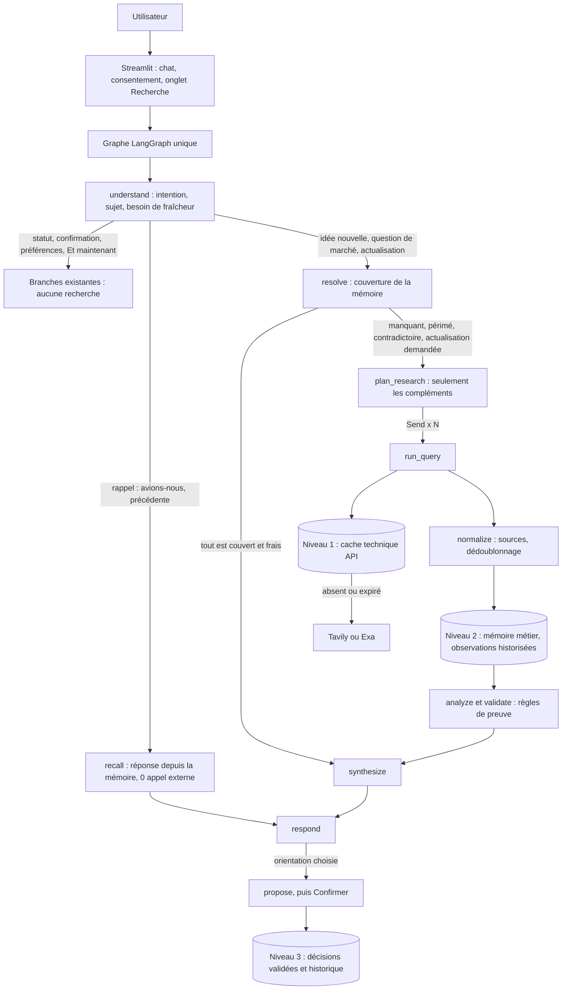

# AI Business Researcher et Strategic Coach : audit et conception

**Statut :** proposition **révisée (v3)**, à valider. **Aucune ligne de code n'a été modifiée.** Aucun appel payant n'a été fait pour cette révision.
**Date :** 10 novembre 2026. Tarifs, modèles et conditions consultés ce jour (sources en annexe).
**Périmètre :** faire évoluer le coach vers un conseiller proactif qui recherche, mémorise, analyse et recommande avant de demander, en conservant planification, confirmation, suivi et `Europe/Paris`.

**Nouveautés de la v2 :**
- mémoire persistante des recherches à trois niveaux (§ 4) ;
- réutilisation et actualisation ciblées (§ 5) ;
- recherche automatique après un consentement unique (§ 6) ;
- **arrêt de `gpt-5-mini` le 11 décembre 2026** et recommandation de modèle (§ 7) ;
- méthode de preuve des plaintes fondée sur l'indépendance des sources (§ 8) ;
- budget, décisions et plan actualisés (§ 9 à 13).

**Nouveautés de la v3 :**
- marché géographique propre à chaque projet, sans valeur par défaut (§ 6.3, D-R10 corrigée) ;
- mémoire étendue aux analyses, questions, réponses, contraintes, décisions et raisons, en réutilisant la persistance existante (§ 4.6, D-R18) ;
- actualisation directe quand l'utilisateur demande une information actuelle (§ 5.1) ;
- vérification détaillée des modèles OpenAI, avec liens précis (§ 7) ;
- tableau de décisions avec avantages, limites et vérifications restantes (§ 13).

---

## 1. Audit de l'architecture actuelle

### 1.1 Ce qui se réutilise tel quel
| Brique | État | Rôle dans la cible |
|---|---|---|
| Graphe LangGraph unique, routage décidé par le code (11 nœuds) | Stable, 545 tests | Un **sous-graphe de recherche** et un **nœud de mémoire** branchés sur `understand`, sans toucher aux branches existantes |
| Garde-fous déterministes (`agent/guards.py`) | Validés en réel | Étendus aux nouvelles intentions (rappel, actualisation) et réutilisés pour les synthèses |
| Port `LLMProvider`, sorties structurées en schéma fermé, clé lue à part et masquée | Validé avec gpt-5-mini | Même patron pour le port `ResearchProvider` ; modèle configurable par usage (§ 7) |
| Actions en attente (aperçu, confirmation, expiration, versions, journal) | Cœur de la sécurité | **Inchangé** : la recherche ne fait que lire ; les choix de l'utilisateur passent par une confirmation |
| SQLite métier et checkpoints, migrations, isolation par `user_id`, export et effacement | Testé | Migration `0002_research.sql`, avec export et effacement étendus |
| Garde-fou budgétaire à réservation du pire cas | Validé en réel | Remonté dans l'application, appliqué à tous les fournisseurs |
| Streamlit, harnais d'évaluation (16 scénarios) | Testés | Onglet « Recherche », carte de consentement, nouveaux scénarios |

### 1.2 Ce qui manque
Il n'y a aujourd'hui ni accès au Web, ni sources, ni mémoire des recherches, ni cache, ni registre de consommation, ni règles de preuve, ni intentions de rappel ou d'actualisation. Enfin, une idée nouvelle déclenche d'abord des questions, alors qu'il faut proposer avant de demander.

### 1.3 Points de friction avec les règles actuelles
- `CLAUDE.md` exclut les API externes non nécessaires : **décision D-R1**.
- « Pas de multi-agent ni RAG » : la conception reste **un seul graphe**. La mémoire est relationnelle (SQLite), **sans base vectorielle**.
- **`gpt-5-mini` est arrêté le 11 décembre 2026** : cela concerne aussi le coach actuel, indépendamment de la recherche (§ 7, D-R2).

---

## 2. Solutions existantes (réutiliser avant de développer)
| Composant | Existant | Recommandation |
|---|---|---|
| **Tavily** | SDK `tavily-python`, intégration `langchain-tavily` (Search, Extract, Map, Crawl) ; paramètre `max_age_hours` pour le cache côté Tavily | SDK derrière notre port `ResearchProvider` |
| **Exa** | SDK `exa-py` ; `/search` avec catégories `company`, `news`, `financial report`, `publication` ; `/contents` ; estimation du coût renvoyée (`costDollars`) | SDK, limité aux concurrents et aux finances |
| **Reddit** | Data API (OAuth), PRAW | **Approbation préalable requise** (Responsible Builder Policy) ; commercial seulement avec accord écrit. Pages officielles **non lisibles par mes outils** : à vérifier. **Pas d'API en V1** |
| **OpenAI** | Outil `web_search` intégré (10 $ pour 1 000 appels, plus les jetons) | Pas en V1 (coût et sources moins contrôlables) |
| **LangGraph** | `Send` (exécution parallèle), sous-graphes, `ToolNode`, `create_react_agent` | Sous-graphe et `Send` ; **pas de boucle ReAct libre** |
| **open_deep_research** | MIT, **archivé le 21 août 2026** | Référence de conception uniquement |
| **gpt-researcher** | Apache-2.0, rapports longs | Référence uniquement |

---

## 3. Architecture technique cible

**Principes (inchangés) :**
- **Le modèle propose, le code décide** : outils, plafonds et réutilisation sont choisis par le code.
- **Aucun outil d'écriture** pour le modèle.
- **Contenu Web délimité,** jamais traité comme une consigne.
- **Preuve obligatoire** pour tout fait affiché.
- **Synthèse courte,** avec les détails à part.
- **Confirmation explicite** pour toute écriture métier.

---

## 4. Stockage, cache et mémoire : trois niveaux

### 4.1 Rôles
| Niveau | Contenu | Durée | Vu par l'utilisateur ? | Autorité |
|---|---|---|---|---|
| **1. Cache technique** (`api_cache`) | Réponse normalisée d'un appel (fournisseur, point d'accès, paramètres) | Courte, technique (24 h par défaut, au plus la fraîcheur du sujet) ; **seul niveau purgeable automatiquement** | Non | Évite de repayer **exactement la même requête** ; n'est jamais cité directement |
| **2. Mémoire métier** (sources, entités, observations, constats, recommandations) | Faits, estimations et hypothèses, avec sources, dates de consultation et de dernière vérification | **Toute la durée du projet**, historisée, **jamais supprimée par la fraîcheur** (§ 4.5) | Oui (onglet Recherche, rappels) | Base des réponses de recherche |
| **3. Décisions et conversation** (`projects`, actions en attente appliquées, événements, checkpoints) | Choix validés par l'utilisateur (segment, positionnement, plan) et historique du dialogue | Durable | Oui | **Prime sur tout** pour les choix de l'utilisateur ; la conversation n'est jamais une source de faits |

### 4.2 Règles d'interaction (sans doublons ni contradictions)
1. **Une seule voie d'alimentation :** cache → normalisation → mémoire métier. Un résultat du cache réutilisé ne crée pas de nouvelle source si l'URL canonique et l'empreinte du contenu existent déjà ; seule la date de dernière vérification change.
2. **Mémoire en ajout seul :** une nouvelle valeur (un prix, par exemple) crée une **nouvelle observation**. L'ancienne passe à `superseded` (remplacée) ou `contradicted` (contredite), sans être effacée. La vue « actuelle » est calculée.
3. **Les décisions figent leur contexte :** quand l'utilisateur confirme un segment, l'action en attente enregistre la recommandation et les identifiants des constats **à ce moment-là**. Une actualisation ultérieure ne modifie jamais une décision ; elle peut proposer une révision, qu'il faudra confirmer.
4. **La conversation n'est pas une source :** une affirmation passée de l'agent n'est réaffichée que si elle est rattachée à la mémoire métier.
5. **Identité des entités :** un concurrent est identifié par projet, par son domaine principal normalisé, sinon par son nom normalisé. Un segment, par projet et nom normalisé. Une offre, par concurrent et libellé normalisé.

### 4.3 Schéma (migration `0002_research.sql`)
Toutes les tables portent `user_id`, et `project_id` quand c'est pertinent. Aucune requête ne lit les données d'un autre utilisateur. Toutes sont incluses dans l'export et l'effacement.

| Table | Colonnes principales |
|---|---|
| `research_runs` | `id`, `user_id`, `project_id`, `topic`, `trigger` (`auto_idea`, `question`, `refresh`), `market_scope` (marché du projet au moment de la recherche, langue des sources), `params_json`, `status` (`running`, `done`, `partial`, `failed`, `budget_stopped`, `memory_only`), `started_at`, `finished_at`, `external_calls`, `cost_usd_estimated` |
| `research_queries` | `id`, `run_id`, `provider`, `endpoint`, `query_text` (après retrait des données personnelles), `params_json`, `cache_key`, `served_from` (`provider`, `api_cache`, `memory`), `status`, `units`, `cost_usd_estimated`, `duration_ms`, `error_code` |
| `api_cache` | `user_id`, `cache_key` (empreinte de fournisseur, point d'accès et paramètres normalisés), `response_json`, `fetched_at`, `expires_at` |
| `sources` | `id`, `user_id`, `canonical_url`, `domain`, `title`, `source_type`, `quality_tier` (A, B ou C, § 8), `author_hint`, `published_at`, `first_seen_at`, `last_retrieved_at`, `excerpt` (≤ 500 caractères), `content_hash`, `near_dup_key` |
| `entities` | `id`, `user_id`, `project_id`, `kind` (`competitor`, `segment`, `offer`, `complaint_theme`, `channel`, `business_model`), `name`, `normalized_key`, `attributes_json`, `created_at`, `last_verified_at` |
| `observations` | `id`, `entity_id` ou `project_id`, `kind` (`price`, `offer`, `market_size`, `trend`, `revenue`, `margin`, `channel`, `org`, `tech`, `complaint`, `opportunity`, `segment_score`), `value_json`, `nature` (`fait`, `estimation`, `hypothese`), `confidence`, `observed_at`, `last_verified_at`, `freshness_class`, `status` (`current`, `superseded`, `contradicted`, `stale`), `superseded_by`, `run_id` |
| `observation_sources` | `observation_id`, `source_id`, `quote` (≤ 300 caractères) |
| `recommendations` | `id`, `user_id`, `project_id`, `topic`, `statement`, `rationale`, `observation_ids_json`, `uncertainties_json`, `status` (`active`, `superseded`, `accepted`, `rejected`), `created_at`, `run_id` |
| `research_changes` | `id`, `user_id`, `project_id`, `entity_id`, `observation_id`, `change` (`created`, `updated`, `superseded`, `contradicted`, `verified_unchanged`), `before_json`, `after_json`, `at`, `run_id` |
| `answer_cache` | `user_id`, `project_id`, `question_key` (question normalisée), `memory_version`, `answer`, `created_at` |
| `usage_ledger` | `user_id`, `day` (date Europe/Paris), `provider`, `calls`, `units`, `cost_usd_estimated` |

Ajouts à des tables existantes, **par confirmation seulement** :
- `projects.target_segment` et `projects.positioning` ;
- `projects.market_scope` (pays ou zone commerciale, langue des sources), **sans valeur par défaut** (§ 6.3). C'est une donnée commerciale, distincte du fuseau horaire technique `Europe/Paris`, qui reste inchangé ;
- dans `preferences` : `research_enabled`, `research_consent_at`, `research_consent_version` et `research_daily_budget_usd`.

**`memory_version` :** un compteur par projet, incrémenté à chaque écriture dans la mémoire métier. Il invalide automatiquement le cache des réponses.

### 4.4 Fraîcheur (configurable, jamais garantie)
| Classe de fraîcheur | Valeur initiale | Exemples |
|---|---|---|
| `price` | 7 jours | Tarifs, promotions, offres |
| `complaint` | 14 jours | Plaintes, avis |
| `market`, `competitor`, `channel` | 30 jours | Concurrents, tendances, canaux |
| `financial` | 90 jours | Chiffres d'affaires, résultats publiés |
| `structural` | 180 jours | Modèle économique, organisation, technique observable |

Ces durées sont réglables par variables (`NEUROCOACH_FRESHNESS_PRICE_DAYS`…) et par projet. **Une donnée « fraîche » n'est pas une donnée garantie** : elle est affichée « vérifiée le 3 novembre 2026 », jamais « actuelle » sans vérification dans le tour en cours.

**La fraîcheur ne supprime rien.** Elle détermine seulement si une information doit être revérifiée avant d'être réutilisée comme base d'une recommandation. Une observation qui dépasse sa durée passe à l'état calculé « à revérifier » : elle reste consultable, avec sa date et sa source (§ 4.5).

### 4.5 Politique de conservation (D-R17)
| Donnée | Conservation | Expiration de la fraîcheur | Suppression |
|---|---|---|---|
| **Mémoire métier** : recherches, requêtes, sources et extraits, entités, observations (y compris remplacées ou contredites), recommandations, historique des changements | **Pendant toute la durée du projet** | Marquée « à revérifier » ; **jamais supprimée**, ni masquée de l'historique | Seulement **à la demande de l'utilisateur** : suppression du projet, effacement complet, ou suppression ciblée d'une recherche ou d'une source. Toujours **après confirmation** (action en attente), comme aujourd'hui |
| **Valeurs anciennes** lors d'une actualisation | Conservées avec leur date d'observation et de vérification, et leur source | — | Avec le projet ou sur demande |
| **Décisions validées** (segment, positionnement, plan) et contexte figé au moment du choix | Pendant toute la durée du projet | Sans objet : une décision ne « périme » pas, elle peut seulement être révisée par une nouvelle confirmation | Avec le projet ou sur demande |
| **Conversation** (checkpoints) | Comme aujourd'hui, jusqu'à la suppression du projet ou l'effacement | — | Avec le projet ou sur demande |
| **Cache technique des API** (niveau 1) | Peut être purgé après expiration | Purge autorisée, car son contenu **utile est déjà normalisé dans la mémoire métier**. Il ne sert qu'à éviter de repayer une requête identique | Automatique, ou avec le projet |
| **Cache des réponses** | Invalidé dès que `memory_version` change | Purge autorisée : c'est une donnée dérivée, recalculable sans appel externe | Automatique, ou avec le projet |
| **Registre de consommation** | Durée du compte (suivi des coûts) | — | Avec l'effacement complet |

**Règles :**
1. **Aucune suppression automatique de données métier**, quelle que soit leur ancienneté.
2. **Une actualisation n'écrase jamais.** Elle ajoute une observation, marque l'ancienne `superseded` ou `contradicted`, et consigne l'événement dans `research_changes`. Les comparaisons historiques (« 24 € le 3 novembre → 27 € le 10 novembre ») restent possibles à tout moment.
3. **Affichage :** une information « à revérifier » est montrée avec sa date et la mention « à revérifier », et n'est jamais présentée comme actuelle. Elle peut servir au rappel (« d'après notre analyse du 3 novembre »), mais pas de base à une nouvelle recommandation sans revérification ou sans avertissement explicite.
4. **Export :** tout est exporté, historique compris (anciennes valeurs, dates, sources, recommandations, décisions), dans le JSON existant, avec une section `research`.
5. **Suppression à la demande :**
   - **Projet** : la suppression existante est étendue à toute la mémoire du projet.
   - **Effacement complet** : il est étendu à tous les niveaux.
   - **Suppression ciblée** (nouvelle) : une recherche, une source ou un concurrent, avec un aperçu de ce qui disparaîtra (observations, recommandations rattachées) puis une confirmation.
   - Dans tous les cas, il ne reste que la trace anonyme de l'action, comme aujourd'hui.
6. **Taille** : les extraits sont bornés (500 et 300 caractères) et aucune page entière n'est conservée. La mémoire d'un projet reste donc légère, ce qui permet de conserver l'historique sans purge.

### 4.6 Mémoire du conseil : analyses, questions, réponses et décisions (D-R18)
Objectif : reprendre une conversation plusieurs jours plus tard **sans refaire l'analyse ni reposer une question déjà répondue**. Le principe : **réutiliser ce qui existe déjà** et n'ajouter que ce qui manque.

| Donnée | Où elle vit | Réutilisé ou nouveau |
|---|---|---|
| Analyses produites par le coach (synthèse structurée, version, recherche d'origine) | `analyses` (`id`, `project_id`, `run_id`, `summary_json`, `version`, `created_at`, `status`) | **Nouveau** |
| Segments proposés et leurs justifications | `entities` (`kind=segment`) et `observations` (`segment_score`, avec sources) | Prévu en v2 |
| Recommandations stratégiques et preuves associées | `recommendations` et `observation_ids_json` (vers `observation_sources`) | Prévu en v2 |
| Questions déjà posées | `project_questions` (`question_key` comme `target_market`, `budget`, `time`, `segment_choice` ; `text`, `asked_at`, `status` : `asked`, `answered`, `skipped`, `obsolete` ; `answer_ref`) | **Nouveau**, petit |
| Réponses et contraintes données par l'utilisateur | **Fiche du projet existante** (`target_outcome`, `constraints`, `available_minutes_per_day`, `facts`), plus `project_context` pour ce qui n'y a pas de place (budget, marché, préférences commerciales) : `key`, `value`, `stated_at`, `source_message_ref`, `status` (`current` ou `superseded`) | Fiche **réutilisée**, `project_context` **nouveau** |
| Choix validés | **Actions en attente appliquées** (`pending_actions` : aperçu, contenu, `applied`) et **événements** (`activity_events`) | **Réutilisé** |
| Choix refusés | Actions en attente `cancelled` et événements | **Réutilisé** |
| Choix reportés (« plus tard ») | `decision_notes` (`subject_ref`, `outcome=postponed`, `reason`, `at`) | **Nouveau**, petit |
| Raisons des décisions | `decision_notes.reason` (résumé de la raison donnée, rattaché à l'action en attente ou à la recommandation) | **Nouveau**, sans doublon : il complète les actions en attente, sans les recopier |
| Plans proposés | `pending_actions` de type `plan.create` (contenu complet du plan, statut) | **Réutilisé** |
| Plans confirmés | `phases`, `tasks`, `task_dependencies` et événements | **Réutilisé** |
| Fil de conversation | Checkpoints LangGraph existants | **Réutilisé**, jamais utilisé comme source de faits |

**Règles :**
1. **Aucune recopie :** une décision n'est pas recopiée dans une nouvelle table. Elle est lue dans les actions en attente et les événements, et `decision_notes` n'ajoute que la raison et le report.
2. **Pas de question déjà répondue :** avant de poser une question, le code consulte `project_questions` et la fiche du projet. Si la réponse existe et reste `current`, elle est réutilisée et rappelée (« Vous m'aviez indiqué un budget de 200 € »). La question n'est reposée que si l'information est marquée obsolète, ou si l'utilisateur la modifie.
3. **Réponses et contraintes :** elles sont **enregistrées dans `project_context` sans confirmation**, car ce sont les paroles de l'utilisateur, comme la conversation aujourd'hui. Elles sont visibles et supprimables dans l'onglet « Ce que je sais de votre projet ». Leur **promotion** dans la fiche du projet, l'orientation ou le plan **reste soumise à confirmation** (D-R18). Une nouvelle valeur remplace l'ancienne, qui reste dans l'historique.
4. **Reprise après plusieurs jours :** un **résumé de reprise** est construit à partir de la base, sans appel au modèle : dernière analyse et sa date, recommandation active, choix validés, refusés ou reportés, questions ouvertes, avancement du plan. Les éléments « à revérifier » sont signalés.
5. **Les informations obsolètes** restent dans l'historique avec leur date, et ne sont jamais présentées comme actuelles (§ 4.5).
6. **Isolation, export et suppression :** même règle que le reste de la mémoire, par utilisateur et par projet (§ 4.5).

---

## 5. Réutilisation et actualisation : fonctionnement exact

### 5.1 Nouvelles intentions
| Intention | Exemples | Effet |
|---|---|---|
| `recall` (rappel) | « Quels concurrents avions-nous identifiés hier ? », « Quelles plaintes avions-nous trouvées ? », « Rappelez-moi votre recommandation précédente. » | **Mémoire seule, 0 appel externe** |
| `staleness_check` (fraîcheur) | « Depuis quand avons-nous ces informations ? » | Mémoire seule : âge et classe de fraîcheur, sans appel |
| `refresh` (actualisation) | « Est-ce que les prix de ces concurrents ont changé ? », « Les informations sur ce concurrent sont-elles toujours à jour ? », « Vérifiez les prix actuels » | **Vérification directe, sans confirmation supplémentaire**, si le consentement existe, si les outils sont disponibles et si le budget le permet ; limitée aux entités concernées, puis comparaison de l'ancien et du nouveau |
| `market_question` | Prix, concurrents, plaintes, revenus, canaux | Résolution par la mémoire d'abord (§ 5.2) |
| `idea_analysis` | Idée nouvelle | Résolution par la mémoire, puis recherche complète si rien n'existe |

Les mots-clés du rappel (« avions-nous », « précédent », « rappelez-moi », « hier ») et de l'actualisation (« à jour », « actuel », « vérifiez », « ont changé ») sont aussi reconnus **par le code**, comme les garde-fous actuels.

**Actualisation impossible.** L'agent dit pourquoi : recherche désactivée, consentement absent, budget atteint, ou service indisponible. Il répond ensuite avec les dernières données enregistrées, **clairement séparées** des données vérifiées récemment, par exemple : « Dernier relevé enregistré : 24 € le 3 novembre 2026 (non revérifié). Je n'ai pas pu vérifier aujourd'hui : budget du jour atteint. »

### 5.2 Algorithme de résolution par la mémoire, avant toute recherche
1. **Réponse identique en cache :** même question normalisée, même projet, même `memory_version` → réponse enregistrée, **sans appel au modèle ni au fournisseur**.
2. **Dimensions requises** pour le sujet (par exemple, pour `pricing` : offres et prix des concurrents connus).
3. **Couverture** de chaque dimension par la mémoire :

   | État | Condition |
   |---|---|
   | Couverte | Au moins une observation `current`, fraîche selon sa classe, confiance moyenne ou élevée, sans contradiction ouverte |
   | Insuffisante | Absente, ou confiance faible |
   | Périmée | Plus ancienne que sa classe de fraîcheur |
   | Contradictoire | Observations incompatibles |
4. **Plan de compléments :** seulement les dimensions insuffisantes, périmées ou contradictoires, et toutes celles visées par une actualisation explicite.
5. **Avant chaque appel :** vérification du cache technique (niveau 1). En cas d'absence ou d'expiration, l'appel est fait dans les limites du budget.
6. **Normalisation :** sources dédoublonnées (URL canonique, empreinte, quasi-doublons).
   - **Valeur identique :** l'observation est marquée `verified_unchanged` et sa `last_verified_at` est mise à jour.
   - **Valeur différente :** une nouvelle observation est créée et l'ancienne passe à `superseded`.
   - **Sources incompatibles :** l'observation passe à `contradicted`, et la confiance est abaissée.
   - Dans tous les cas, l'événement est consigné dans `research_changes`.
7. **Synthèse :**
   - Chaque élément indique son origine : « vérifié aujourd'hui » ou « enregistré le 3 novembre, non revérifié ».
   - Les comparaisons affichent : « T. Bougies : 24 € → 27 € (vérifié aujourd'hui ; ancienne valeur du 3 novembre) ».

### 5.3 Exemples
| Question | Appels externes | Réponse |
|---|---|---|
| « Quels concurrents avions-nous identifiés hier ? » | 0 | Liste depuis la mémoire, avec « identifiés le 9 novembre 2026, non revérifiés depuis » |
| Même question, posée une seconde fois | 0 (et 0 appel au modèle) | Réponse identique reprise du cache des réponses |
| « Les infos sur Atelier Lumière sont-elles à jour ? » | Seulement les dimensions périmées (les prix, plus vieux que 7 jours), cache technique d'abord | « Prix revérifiés aujourd'hui : inchangés (24 €). Offre vérifiée il y a 9 jours, encore dans sa durée de fraîcheur (30 jours), donc non revérifiée. » |
| « Quels prix ont changé depuis notre dernière analyse ? » | Seulement les pages de prix des concurrents connus (cache technique d'abord) | Différences ancien et nouveau ; « inchangé » pour ceux qui n'ont pas bougé |
| Idée déjà analysée il y a 10 jours | Seulement les prix (périmés) | Synthèse indiquant les parties revérifiées et les parties issues de la mémoire |

### 5.4 Tests de non-régression prévus
1. **Deuxième question identique**, données valides : **0 appel au faux fournisseur de recherche et 0 appel au faux LLM**, via le cache des réponses.
2. **Question reformulée** sur des données valides : 0 appel de recherche. Un seul petit appel de classification est accepté (environ 0,0002 $).
3. **Données périmées :** seuls les compléments sont recherchés ; les dimensions fraîches ne déclenchent aucun appel.
4. **Actualisation demandée :** recherche limitée aux entités concernées, puis comparaison et historique dans `research_changes`.
5. **Libellés :** une donnée de la mémoire n'est jamais libellée « vérifiée aujourd'hui » sans vérification dans le tour en cours.
6. **Isolation :** les mémoires et caches de deux utilisateurs ne se croisent pas.
7. **Effacement et export :** les recherches sont exportées, puis totalement effacées.
8. **Décision figée :** une actualisation ne modifie pas un segment déjà confirmé.
9. **Aucune suppression par la fraîcheur** : en avançant l'horloge de test au-delà de 7, 30, 90 et 180 jours, toutes les observations, sources et recommandations restent présentes, marquées « à revérifier ».
10. **Historique conservé :** après deux actualisations d'un prix, les trois valeurs restent consultables avec leurs dates et leurs sources ; la comparaison ancienne et nouvelle valeur est possible.
11. **Suppression ciblée** : uniquement après confirmation, avec un aperçu exact de ce qui disparaît ; rien d'autre n'est touché.
12. **Purge du cache technique :** une entrée expirée de `api_cache` peut disparaître sans qu'aucune donnée métier ne soit perdue.

---

## 6. Recherche automatique et consentement

### 6.1 Mécanisme
1. **Consentement unique**, présenté à la première idée nouvelle sous forme de carte au-dessus du chat :
   > Pour analyser votre marché, j'envoie des requêtes de recherche à **Tavily** et **Exa**, et l'analyse à **OpenAI**. Votre idée est résumée en mots-clés (produit, secteur, pays). Votre nom, vos coordonnées et vos messages complets ne sont pas transmis. Budget : **1 $ par jour au maximum**. Vous pouvez désactiver ces recherches à tout moment dans les Préférences.
   >
   > [Autoriser les recherches automatiques] [Pas maintenant]
2. **Après autorisation :** les recherches se déclenchent automatiquement (idée nouvelle, question de marché, actualisation demandée), **sans confirmation à chaque appel**, dans la limite du budget. Une ligne de progression indique ce qui est recherché.
3. **« Pas maintenant » :** le coach fonctionne comme aujourd'hui (questions et plan). Il propose à nouveau la recherche une seule fois, au prochain besoin réel, puis plus jamais sans demande.
4. **Préférences :**
   - un interrupteur « Recherche externe » ;
   - le budget par jour ;
   - la liste des services utilisés ;
   - la consommation du jour et du mois.
5. **Nouveau consentement** obligatoire si la liste des services change (`research_consent_version`).
6. **Garanties :** l'autorisation ne vaut que pour la **lecture**. Aucune écriture métier sans confirmation. La recherche ne s'applique jamais aux actions de suivi.

### 6.2 Minimisation des données envoyées
- Les requêtes sont **produites par le modèle** à partir de l'idée, puis **contrôlées par le code** :
  - au plus 25 mots ;
  - adresses e-mail, téléphones, URL privées et noms de personnes retirés ;
  - aucun identifiant interne.
- Le texte complet de l'utilisateur et l'historique ne sont jamais envoyés aux fournisseurs de recherche.
- Le titre du projet n'est pas envoyé tel quel.
- Seuls le marché du projet et la langue des sources (`market_scope`, § 6.3) sont transmis comme paramètres.
- Clés lues à part et masquées, comme aujourd'hui. Aucun traçage externe.

### 6.3 Marché géographique (D-R10 corrigée)
- **Aucun marché par défaut.** Le marché étudié dépend du projet : Maroc, France, un autre pays, une zone, ou l'international.
- **Réutilisation :** le marché déjà connu dans le contexte du projet (`projects.market_scope`, `project_context`, ou une mention claire comme « à Casablanca » ou « en ligne dans toute l'Europe ») est repris sans question.
- **Question unique :** si le marché est **indispensable** au sujet (prix, concurrents locaux, réglementation, canaux) et **inconnu**, l'agent pose **une seule question** avant toute recherche ciblée : « Dans quel pays ou quelle zone souhaitez-vous vendre en priorité ? ». La réponse est enregistrée dans `project_context`, et n'est donc plus jamais redemandée.
- **Recherche non ciblée possible** si le sujet ne dépend pas du pays (tendances générales, modèles économiques). Elle est signalée comme « internationale, non spécifique à votre marché ».
- **Paramètres :** le pays sert de paramètre de recherche (par exemple `country` chez Tavily, à confirmer à l'intégration) et la langue des requêtes suit le marché (arabe, français, anglais…). Les sources affichent leur pays quand il est connu.
- **Fuseau horaire :** `Europe/Paris` reste le fuseau **technique** de l'application (dates, journal, consommation par jour), indépendamment du marché commercial étudié.

---

## 7. Modèle OpenAI : vérification et recommandation

### 7.1 Vérification dans la documentation officielle (10 novembre 2026)
| Affirmation | Lien officiel précis |
|---|---|
| `gpt-5-mini` : statut **« Deprecated »** ; instantané `gpt-5-mini-2025-08-07` ; 0,25 $ / 0,025 $ (entrée mise en cache) / 2,00 $ par million de jetons ; Chat Completions et Responses ; sorties structurées et appels de fonctions | https://developers.openai.com/api/docs/models/gpt-5-mini |
| **Arrêt le 11 décembre 2026** (annonce du 11 juin 2026, « GPT-5 and o3 model deprecations ») ; remplacement recommandé : **`gpt-5.6-terra`**. `gpt-5-nano` est remplacé par `gpt-5.6-luna`, et `gpt-5` par `gpt-5.6-sol` | https://developers.openai.com/api/docs/deprecations |
| `gpt-5.6-terra` : identifiant exact `gpt-5.6-terra` (instantané unique) ; **Chat Completions, Responses et Batch** ; sorties structurées et appels de fonctions pris en charge ; effort `none`, `low`, `medium` (par défaut), `high`, `xhigh`, `max` ; contexte de 1 050 000 jetons et sortie de 128 000 ; 2,00 $ / 0,20 $ / 12,00 $ par million ; « correspond à peu près au niveau mini » | https://developers.openai.com/api/docs/models/gpt-5.6-terra |
| `gpt-5.6-luna` : identifiant exact `gpt-5.6-luna` ; Chat Completions, Responses et Batch ; sorties structurées et appels de fonctions ; mêmes niveaux d'effort ; 0,20 $ / 0,02 $ / 1,20 $ par million ; « correspond à peu près au niveau nano » ; volume élevé et coût faible | https://developers.openai.com/api/docs/models/gpt-5.6-luna |
| `gpt-5.4-mini` : identifiant `gpt-5.4-mini` (instantané `gpt-5.4-mini-2026-03-17`), non déprécié ; 0,75 $ / 0,075 $ / 4,50 $ par million ; sorties structurées et appels de fonctions | https://developers.openai.com/api/docs/models/gpt-5.4-mini |
| Tableau des tarifs (tous modèles, dont `gpt-5.6-sol` à 4 $ / 20 $) | https://developers.openai.com/api/docs/pricing |
| Limites de débit au premier niveau (« Build ») : Terra 5 000 requêtes et 1 000 000 de jetons par minute ; Luna 5 000 requêtes et 2 000 000 de jetons par minute. La fiche précise qu'une limite affichée **ne garantit pas l'accès** au modèle pour un compte donné | Fiches Terra et Luna ci-dessus |

**Compatibilité avec le projet**, vérifiée dans le code installé de `langchain-openai` 1.7.4, sans aucun appel :
- Le projet appelle Chat Completions, que Terra et Luna prennent en charge.
- La bibliothèque n'impose l'API Responses qu'à une liste de modèles (`gpt-5-pro`, `gpt-5.2-pro`, `gpt-5.4-pro`, `gpt-5.5-pro`, `gpt-5.6-sol`) : **Terra et Luna n'y figurent pas**.
- Pour les modèles `gpt-5*`, aucune `temperature` n'est envoyée et le plafond de sortie passe par `max_completion_tokens`.
- L'effort (`reasoning_effort`) est transmis tel quel ; les valeurs `low` et `medium` existent sur les deux modèles.
- Sorties structurées en `json_schema` non strict : prises en charge par les deux modèles.

**À vérifier au début de R0, sans coût :**
1. L'accès réel de **ton** compte, par la liste des modèles (`GET /v1/models`, appel gratuit, clé jamais affichée), avec ton accord.
2. Puis un appel de test par modèle, payant mais minime (moins de 0,001 $), et la campagne de comparaison.

**Ce document ne change aucun modèle.**

### 7.2 Comparaison pour notre usage
| Critère | `gpt-5.6-luna` | `gpt-5.4-mini` | `gpt-5.6-terra` |
|---|---|---|---|
| Coût (entrée / sortie, par million de jetons) | **0,20 $ / 1,20 $** (moins que `gpt-5-mini`) | 0,75 $ / 4,50 $ | 2,00 $ / 12,00 $ (8 fois et 6 fois `gpt-5-mini`) |
| Qualité attendue des analyses | Niveau « nano » : suffisante pour classer et reformuler des tâches encadrées, **à prouver** pour l'analyse stratégique | « Meilleur mini » de la génération 5.4 | Niveau « mini » de la génération 5.6, **remplaçant officiel** |
| Sélection d'outils | Appels de fonctions pris en charge ; non utilisés dans notre architecture (le code choisit les outils) | Idem | Idem, plus des outils intégrés |
| Sorties structurées | Oui | Oui | Oui |
| Compatibilité (Chat Completions, `langchain-openai` 1.7.4) | Oui (vérifié dans le code) | Oui | Oui (vérifié dans le code) |
| Pérennité | Génération actuelle | Génération précédente : risque d'arrêt plus tôt | Génération actuelle |

### 7.3 Recommandation
**Deux usages, deux modèles configurables**, sans changer l'architecture (une variable de plus) :

| Usage | Modèle recommandé | Raison |
|---|---|---|
| Classification, clarification, réponses du coach, modifications : les usages actuels | **`gpt-5.6-luna`** | Moins cher que `gpt-5-mini` ; ces tâches sont courtes et très encadrées par le code |
| Planification des recherches, analyse stratégique, synthèse | **`gpt-5.6-terra`**, effort `low` ou `medium` | Remplaçant officiel du niveau mini ; qualité d'analyse nécessaire pour comparer segments et concurrents |

**Conditions :**
- **Ne rien changer maintenant**, comme demandé.
- En R0, une campagne de comparaison plafonnée sur les 16 scénarios existants, pour environ 0,15 $, **après ton accord**.
- Basculer **avant le 11 décembre 2026**.
- Si `gpt-5.6-luna` échoue sur les tâches actuelles, utiliser `gpt-5.6-terra` pour tout, avec un coût plus élevé (§ 9).

---

## 8. Validation des plaintes clients

La règle « 3 plaintes sur 2 sites » est **abandonnée** : elle ne résiste ni aux textes copiés, ni aux faux avis, ni aux publications dépendantes les unes des autres.

### 8.1 Méthode : des unités de preuve indépendantes
1. **Qualité de la source** (`quality_tier`) :

   | Niveau | Sources |
   |---|---|
   | **A** | Plateformes d'avis à achat vérifié, organismes de consommateurs, médiateurs, presse reconnue citant des cas |
   | **B** | Forums et communautés établis (historique, modération), avis sur des places de marché |
   | **C** | Sites inconnus, contenus optimisés pour le référencement, pages d'affiliation, comparateurs commerciaux |
2. **Indépendance** : on regroupe ce qui n'est pas indépendant, et un groupe compte pour **une seule** unité de preuve :
   - textes quasi identiques (recouvrement de mots ≥ 60 % sur l'extrait) ;
   - même auteur ou pseudonyme ;
   - même URL canonique, ou contenu syndiqué ;
   - article qui en cite un autre.
3. **Date** : pleine valeur jusqu'à 12 mois ; demi-valeur de 12 à 36 mois ; au-delà, seulement à titre historique.
4. **Contexte** : la plainte doit porter sur le produit ou la catégorie, le marché et la langue visés. Sont exclus :
   - les messages promotionnels ou de concurrents ;
   - les textes hors sujet ;
   - les avis extrêmes sans aucun détail concret (indice de faux avis).
5. **Thème** : les plaintes sont regroupées par thème normalisé, par exemple « tenue du parfum » ou « délai de livraison ».

### 8.2 Niveaux affichés
| Niveau | Condition minimale | Formulation |
|---|---|---|
| **Signal faible** | 1 ou 2 unités indépendantes, ou seulement des sources de niveau C | « Signalé ponctuellement (2 sources) » |
| **Tendance à confirmer** | ≥ 3 unités indépendantes sur ≥ 2 domaines, dont ≥ 1 de niveau A ou B, et une majorité de moins de 24 mois | « Revient dans plusieurs sources indépendantes (4), à confirmer » |
| **Problème documenté** | ≥ 5 unités indépendantes sur ≥ 3 domaines, dont ≥ 2 de niveau A ou B, une majorité de moins de 24 mois, et un thème cohérent | « Problème documenté (6 sources indépendantes, 2023-2026) » |

**Règles d'expression :**
- Jamais de proportion (« la plupart des clients », « 30 % des clients ») sans source qui la mesure : on ignore le nombre total de clients.
- Toujours afficher le nombre d'unités, les domaines, la période et deux exemples avec leurs liens.
- La détection des faux avis reste **heuristique** : c'est une limite à afficher dans les détails.
- Les seuils sont des réglages, et non des vérités statistiques.

---

## 9. Budget estimé (actualisé)

Tarifs consultés le 10 novembre 2026 :

| Fournisseur | Offre gratuite | Tarifs payants |
|---|---|---|
| **Tavily** | 1 000 crédits par mois | 0,008 $ par crédit. Recherche basique : 1 crédit ; avancée : 2 crédits ; extraction : 1 crédit pour 5 URL |
| **Exa** | 10 $ par mois | Recherche `auto` : 7 $ pour 1 000 requêtes ; contenus : 1 $ pour 1 000 pages par type |

| Opération | `gpt-5.6-luna` seul | Luna + **Terra pour l'analyse** (recommandé) | Avec les offres gratuites |
|---|---|---|---|
| Analyse d'une idée nouvelle (recherche ≈ 0,14 $ + modèle) | ≈ 0,155 $ | **≈ 0,25 $** (dont environ 0,11 $ de Terra) | ≈ 0,015 à 0,11 $ |
| Question ciblée (2 ou 3 recherches) | ≈ 0,03 $ | ≈ 0,05 $ | ≈ 0,002 à 0,02 $ |
| Actualisation ciblée des prix (3 pages) | ≈ 0,02 $ | ≈ 0,04 $ | ≈ 0,002 à 0,02 $ |
| **Rappel depuis la mémoire** | ≈ 0,0002 $ (classification) | idem | idem |
| **Question identique répétée** | **0 $** (cache des réponses) | **0 $** | 0 $ |
| Suivi, statut, confirmation | ≈ 0,0002 $ | idem | idem |
| Démonstration mensuelle (30 analyses, 100 questions, 50 rappels) | ≈ 1 $ | ≈ 4 $ | — |

**Effet de la mémoire :** une idée réanalysée dans les 30 jours ne revérifie que les dimensions périmées (les prix, en général), soit environ 0,04 $ au lieu de 0,25 $.

**Plafonds proposés (D-R6)** :

| Portée | Plafond |
|---|---|
| Analyse d'idée | 0,40 $ |
| Question ou actualisation | 0,08 $ |
| Par utilisateur et par jour | 1 $ |
| Mensuel global | 10 $ |
| Nombre d'appels externes par analyse | 15 |
| Délai | 20 s par appel, 90 s par analyse |

Tous les plafonds reposent sur une réservation du pire cas, sans nouvelle tentative automatique, sauf une seule après un 429 ou un 503. Les tableaux de bord des fournisseurs font foi.

---

## 10. Gestion des erreurs
| Situation | Comportement |
|---|---|
| Budget insuffisant | Aucun appel. Réponse depuis la mémoire si elle existe, avec ses dates ; sinon « analyse partielle : budget atteint » |
| Délai dépassé | Recherche marquée `partial` ; la synthèse ne porte que sur les sources obtenues |
| 429 ou 503 | Une seule nouvelle tentative différée, puis passage à l'autre fournisseur si le sujet le permet |
| 401 ou 403 | Fournisseur désactivé, message de configuration, clé jamais affichée |
| 402 (crédits Exa épuisés) | Exa est désactivé pour la journée |
| Aucun résultat pertinent | « Je n'ai pas trouvé de données fiables », suivi des hypothèses à vérifier. **Jamais de contenu inventé** |
| Tous les fournisseurs indisponibles | Mémoire datée, ou conseil entièrement étiqueté « hypothèses » |
| Sources contradictoires | Fourchette affichée avec les sources, observation `contradicted`, confiance abaissée |

---

## 11. Expérience conversationnelle proactive

Les règles de la v1 sont conservées :
- proposer avant de demander, une seule question, environ 8 lignes ;
- « Fait vérifié », « Estimation » et « Hypothèse » écrits en toutes lettres, sources numérotées, onglet « Recherche » ;
- orientation confirmée avant le plan, jamais de promesse de réussite.

La v2 ajoute :
- **les dates partout** : « vérifié aujourd'hui » ou « enregistré le 3 novembre, non revérifié » ;
- **les rappels sans recherche** : « D'après notre analyse du 9 novembre : … Voulez-vous que je vérifie si c'est toujours à jour ? » ;
- **les comparaisons après actualisation**, courtes : seules les valeurs qui ont changé, puis « 4 autres inchangées » ;
- **la carte de consentement unique** (§ 6), puis des recherches automatiques avec une ligne de progression.

---

## 12. Tests prévus
| # | Exigence | Tests automatiques (faux fournisseurs scriptés, compteurs d'appels) |
|---|---|---|
| 1 | Recherche automatique sur une idée nouvelle, après consentement | Sous-graphe lancé ; sans consentement, carte affichée et 0 appel |
| 2 | Bon outil selon la question | Table de routage : prix, concurrents, plaintes, finances |
| 3 | Aucune recherche inutile | Statut, confirmation, préférences, « Et maintenant ? », replanification : 0 appel |
| 4 | Segments proposés avant toute question | Au moins 2 segments, 1 recommandé, une seule question |
| 5 | Recommandations sourcées | Un fait sans source de la mémoire est rétrogradé en hypothèse |
| 6 | Faits, estimations, hypothèses | Chiffre absent de l'extrait → estimation |
| 7 | Plaintes | Textes copiés, même auteur ou syndication = 1 unité ; seuils des 3 niveaux ; aucune proportion inventée |
| 8 | Échecs d'API | Délai, 401, 402, 429, 5xx, vide, contradictions |
| 9 | Budgets | Plafonds par analyse, jour et mois ; arrêt avant dépassement |
| 10 | Non-régression | Les 545 tests existants |
| 11 | **Mémoire** | Les 8 tests du § 5.4 (deuxième question identique : 0 appel payant) |
| 12 | Consentement et confidentialité | Requêtes sans données personnelles ; interrupteur désactivé → 0 appel ; nouveau consentement si la liste des services change |

Validation réelle : campagnes plafonnées et relecture humaine, comme jusqu'ici.

---

## 13. Décisions à valider (v3)
| ID | Décision à prendre | Recommandation | Avantages | Limites | À vérifier encore |
|---|---|---|---|---|---|
| **D-R1** | Autoriser des API externes de recherche (dérogation à la règle « pas d'API externe » de `CLAUDE.md`) | **Oui**, en lecture seule | Rend possible le conseil fondé sur des preuves | Dépendance à des tiers ; données envoyées hors de l'application | Conditions d'utilisation finales de Tavily et Exa au moment de l'ouverture des comptes |
| **D-R2** | Modèle OpenAI, `gpt-5-mini` étant arrêté le 11/12/2026 | Comparer en R0, puis **Luna** pour les usages actuels et **Terra** pour l'analyse | Moins cher pour le quotidien, plus de qualité pour l'analyse, génération actuelle | Deux modèles à valider ; Terra coûte 8 fois plus en entrée | Accès réel du compte (liste gratuite des modèles), qualité réelle (campagne d'environ 0,15 $) |
| **D-R3** | Fournisseurs de recherche | **Tavily et Exa** ; pas le `web_search` d'OpenAI en V1 | Sources et coûts maîtrisés ; offres gratuites mensuelles | Deux comptes et deux clés | Licences des SDK `tavily-python` et `exa-py` ; disponibilité actuelle de la recherche d'entreprises similaires chez Exa |
| **D-R4** | Reddit | **Pas d'API en V1** ; repérage via les moteurs de recherche, avec liens et courts extraits | Aucun accès soumis à approbation ; respect des conditions | Couverture partielle des discussions | **Conditions officielles de Reddit, à lire par toi** (pages inaccessibles à mes outils) |
| **D-R5** | Déclenchement des recherches | **Consentement unique**, puis recherche automatique ; interrupteur pour désactiver ; nouveau consentement si les services changent | Fonction utilisable sans friction, transparente | Un clic initial | Formulation finale de la carte, à relire ensemble |
| **D-R6** | Plafonds | 0,40 $ par analyse ; 0,08 $ par question ou actualisation ; 1 $ par jour et par utilisateur ; 10 $ par mois ; 15 appels par analyse | Coûts bornés par réservation du pire cas, déjà éprouvée | Une analyse peut s'arrêter avant la fin (résultat partiel signalé) | Montants adaptés à ton budget réel |
| **D-R7** | Partage des caches et de la mémoire | **Par utilisateur**, jamais partagés | Confidentialité ; aucune fuite d'une idée entre utilisateurs | Moins d'économies entre utilisateurs | — |
| **D-R8** | Taille des extraits conservés | 500 caractères par source, 300 par citation, aucune page entière | Respect des droits et des conditions ; base légère | Contexte réduit à la relecture | Conditions de réutilisation propres à chaque fournisseur |
| **D-R9** | Estimations financières | Autorisées si elles sont **étiquetées « Estimation »**, avec leur méthode | Utile quand les finances ne sont pas publiées | Risque d'être prises pour des faits | Formulation de l'étiquette, à relire |
| **D-R10** *(corrigée)* | Marché géographique | **Aucun marché par défaut** : celui du projet est réutilisé ; une seule question s'il est indispensable et inconnu ; `Europe/Paris` reste le fuseau technique | Adapté au Maroc, à la France ou à l'international | Une question de plus pour un projet sans marché connu | Paramètres de pays de Tavily et Exa (à confirmer à l'intégration) |
| **D-R11** | Déroulement des recherches | Pendant la conversation, 90 secondes au plus, progression visible | Simple ; pas de tâche de fond à gérer | Attente possible d'une minute | Ressenti réel dans l'interface (R4) |
| **D-R12** | Ce dossier dans le premier commit | **Oui**, comme proposition | Trace de la conception | Document long | — |
| **D-R13** | Mémoire à trois niveaux (cache technique, mémoire métier, décisions) et cache des réponses | **Oui** | Pas de doublons ; question répétée sans coût | Un schéma plus riche (migration 0002) | — |
| **D-R14** | Durées de fraîcheur | 7, 14, 30, 90 et 180 jours au départ, **réglables**, jamais présentées comme une garantie | Moins d'appels ; dates affichées | Une valeur « fraîche » peut avoir changé entre-temps | Durées adaptées à tes secteurs |
| **D-R15** | Preuve des plaintes | **Preuves indépendantes** et 3 niveaux (signal faible, tendance à confirmer, problème documenté) | Résiste aux copies et aux publications dépendantes | Détection des faux avis seulement heuristique | Seuils à ajuster après la première campagne réelle |
| **D-R16** | Décisions figées | Une actualisation ne modifie jamais un choix confirmé ; elle peut proposer une révision à confirmer | Pas de changement silencieux | Une révision demande un clic | — |
| **D-R17** | Conservation | Mémoire métier gardée **toute la durée du projet**, jamais supprimée par la fraîcheur ; anciennes valeurs conservées ; export complet ; suppression seulement à la demande, avec confirmation | Historique et comparaisons ; contrôle par l'utilisateur | La base grossit (extraits bornés) | — |
| **D-R18** *(nouvelle)* | Mémoire du conseil (§ 4.6) : réponses et contraintes de l'utilisateur enregistrées **sans confirmation** dans `project_context`, visibles et supprimables ; leur passage dans la fiche, l'orientation ou le plan **avec confirmation** ; décisions lues depuis les actions en attente et les événements existants, plus les raisons et les reports | **Oui** | Reprise sans refaire l'analyse ni reposer de question ; pas de duplication | Une table de contexte de plus à afficher et gérer | Écran « Ce que je sais de votre projet », à valider en R4 |

---

## 14. Plan d'implémentation (actualisé)
| Étape | Contenu | Coût réel | Critère de sortie |
|---|---|---|---|
| **R0** | Validation des décisions ; création des comptes Tavily et Exa et ajout des clés dans `.env`, par toi ; avec ton accord : liste gratuite des modèles du compte, un appel de test par modèle, puis **campagne de comparaison `gpt-5.6-luna` et `gpt-5.6-terra`** sur les 16 scénarios existants ; choix du modèle et bascule de configuration **avant le 11/12/2026** | ≈ 0,15 $ | Coach actuel validé sur le nouveau modèle |
| **R1** | Domaine et stockage à trois niveaux (migration 0002) ; fraîcheur sans suppression et politique de conservation (D-R17), export et suppression ciblée confirmée ; mémoire du conseil (`analyses`, `project_questions`, `project_context`, `decision_notes`, D-R18) et résumé de reprise ; marché du projet (D-R10) ; consentement et préférences ; budget et registre généralisés ; résolution par la mémoire ; cache des réponses ; faux fournisseurs. **Sans réseau** | 0 $ | Tests 3, 5, 6, 9, 11 et 12 ; non-régression |
| **R2** | Adaptateurs Tavily et Exa ; cache technique ; `check-providers` et `--ping` | < 0,01 $ | Un appel réel par fournisseur ; clés jamais affichées |
| **R3** | Sous-graphe de recherche ; routage (dont rappel, fraîcheur, actualisation) ; règles de preuve ; comparaison ancien et nouveau | 0 $ (faux fournisseurs) | Tests 1, 2, 8 et 11 |
| **R4** | Conseil proactif : segments, recommandation, carte de consentement, onglet Recherche, dates, confirmation de l'orientation, plan | 0 $ | Test 4 et non-régression |
| **R5** | Plaintes : qualité, indépendance, dates, niveaux ; forums et avis via les moteurs ; Reddit officiel seulement si approuvé | 0 $ | Test 7 |
| **R6** | Campagne réelle plafonnée (idées, questions, rappels, actualisations), relecture humaine, documentation, captures | ≈ 1 à 2 $ | Rapport réel ; deuxième question identique à 0 appel payant, mesuré |

Chaque étape s'arrête pour validation, comme les phases précédentes.

---

## 15. Risques et limites
| Risque | Gravité | Atténuation |
|---|---|---|
| **Arrêt de `gpt-5-mini` le 11/12/2026** | **Élevée** | Comparaison et bascule en R0 |
| Concurrents ou chiffres inventés | Élevée | Règles de preuve appliquées par le code, relecture humaine |
| Injection de consignes depuis le Web | Élevée | Contenu délimité, aucun outil d'écriture, sorties validées |
| Conditions d'utilisation de Reddit et des sites d'avis | Élevée | Pas d'extraction directe ni de contournement ; accès officiel après approbation |
| Mémoire périmée présentée comme actuelle | Moyenne | Dates obligatoires, libellés « à revérifier », fraîcheur par classe, sans suppression |
| Perte d'historique lors des actualisations | Moyenne | Observations en ajout seul, `research_changes`, tests de conservation (§ 5.4) |
| Volume de la mémoire à long terme | Faible | Extraits bornés, aucune page entière conservée ; seul le cache technique est purgé |
| Doublons ou contradictions entre niveaux | Moyenne | Une seule voie d'alimentation, observations historisées, décisions figées (§ 4.2) |
| Faux avis et publications dépendantes | Moyenne | Unités indépendantes, niveaux de qualité ; limite heuristique affichée |
| Coût de `gpt-5.6-terra` | Moyenne | Réservé à l'analyse, effort `low`, plafonds, mémoire |
| Confidentialité | Moyenne | Consentement, minimisation, cache par utilisateur, effacement |
| Synthèses trop longues | Moyenne | 8 lignes, une question, détails à part |
| Finances rarement publiques | Faible | « Non documenté » ou estimation étiquetée |

---

## Annexe : sources consultées (10 novembre 2026)
- OpenAI : [gpt-5-mini (statut Deprecated)](https://developers.openai.com/api/docs/models/gpt-5-mini) · [Dépréciations : arrêt le 11/12/2026, remplacement gpt-5.6-terra](https://developers.openai.com/api/docs/deprecations) · [Tarifs](https://developers.openai.com/api/docs/pricing) · [gpt-5.6-terra](https://developers.openai.com/api/docs/models/gpt-5.6-terra) · [gpt-5.6-luna](https://developers.openai.com/api/docs/models/gpt-5.6-luna) · [gpt-5.4-mini](https://developers.openai.com/api/docs/models/gpt-5.4-mini)
- Tavily : [Crédits](https://docs.tavily.com/documentation/api-credits) · [Limites](https://docs.tavily.com/documentation/rate-limits) · [Conditions](https://www.tavily.com/terms) · [Politique d'usage](https://www.tavily.com/acceptable-use-policy) · [LangChain](https://docs.tavily.com/documentation/integrations/langchain) · [langchain-tavily](https://github.com/tavily-ai/langchain-tavily) · [Paramètres de recherche, dont `max_age_hours`](https://docs.tavily.com/documentation/api-reference/endpoint/search)
- Exa : [Tarifs](https://exa.ai/pricing) · [Limites](https://docs.exa.ai/reference/rate-limits) · [Recherche et catégories](https://docs.exa.ai/reference/find-similar-links) · [LangChain](https://docs.langchain.com/oss/python/integrations/tools/exa_search)
- Reddit : [Responsible Builder Policy (non lisible par mes outils)](https://support.reddithelp.com/hc/en-us/articles/42728983564564-Responsible-Builder-Policy) ; sources secondaires non vérifiées : [prowlo.com](https://prowlo.com/blog/reddit-data-api), [redditapis.com](https://www.redditapis.com/reddit-responsible-builder-policy)
- Projets : [open_deep_research (MIT, archivé)](https://github.com/langchain-ai/open_deep_research) · [gpt-researcher (Apache-2.0)](https://github.com/assafelovic/gpt-researcher)
